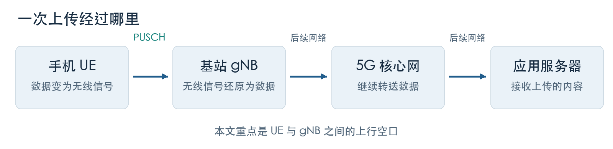
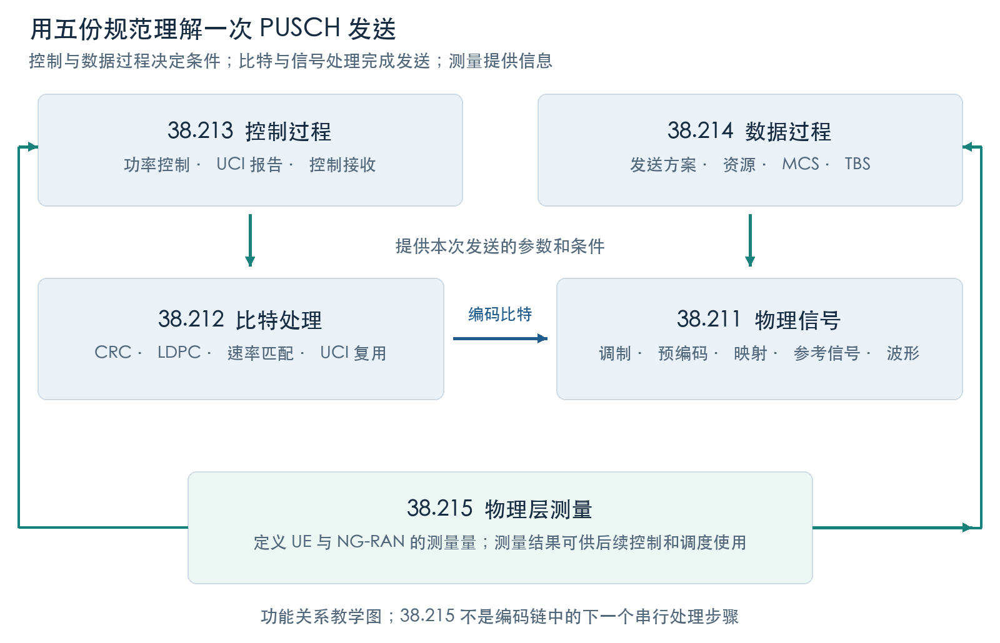
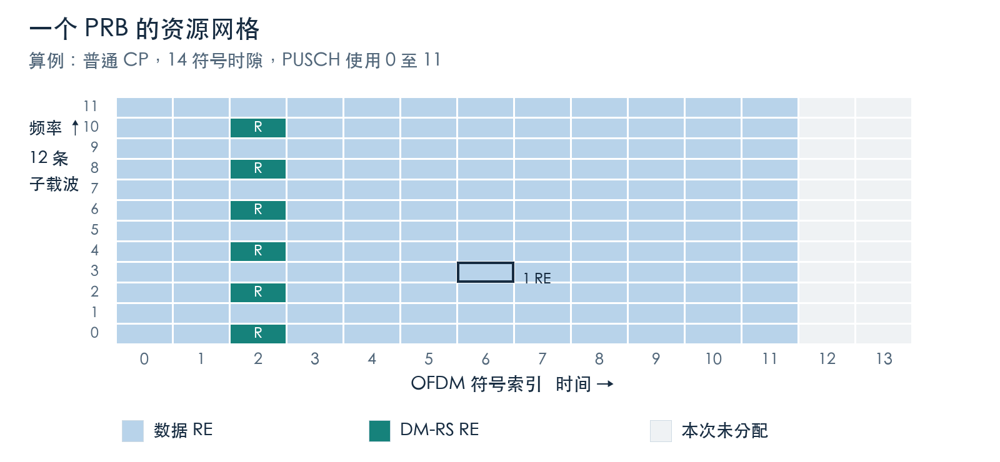
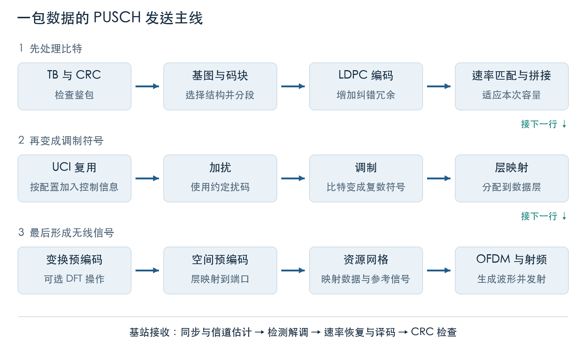
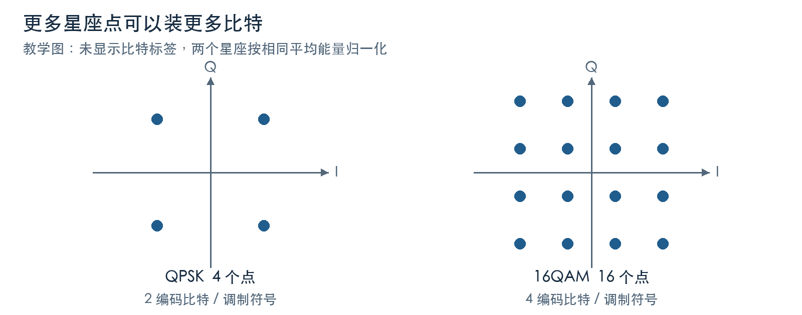
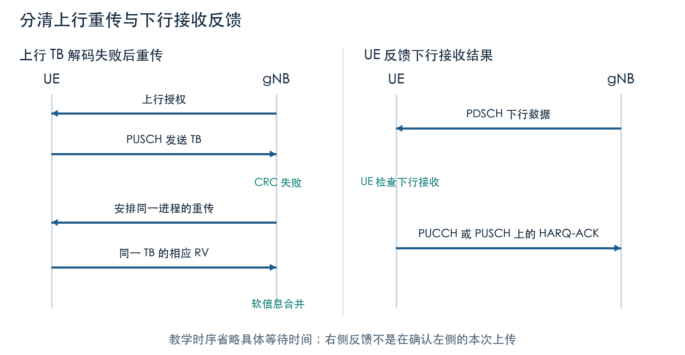
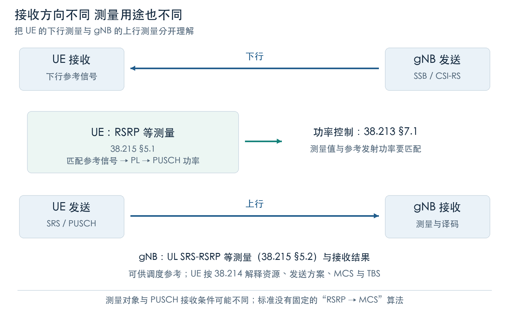
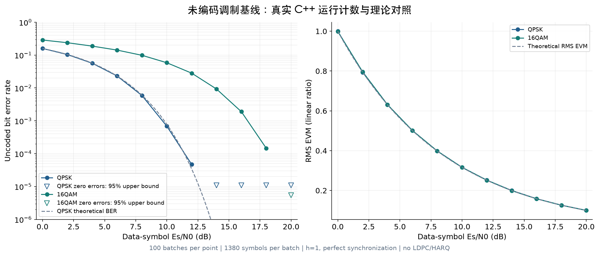

# 5G PUSCH 从零开始的学习文档

面向没有 4G LTE 和 5G NR 基础、准备从事物理层软件开发的读者  
整理日期：2026 年 10 月 8 日；开发路线重写：2026 年 10 月 10 日

**PUSCH 是手机向 5G 基站发送数据时使用的一种物理信道。** 学习它，就是理解手机怎样得到发送机会，怎样把一包二进制数据变成无线信号，以及基站怎样把信号还原成数据。

**本版以 3GPP TS 38.211、38.212、38.213、38.214、38.215 为主要依据。** 文档先补齐零基础读者需要的概念，再把一次 PUSCH 发送对应到这些规范的具体条款。原始 [ShareTechnote PUSCH 页面](https://www.sharetechnote.com/html/5G/5G_PUSCH.html)与参考实现文档作为辅助材料，集中放在第 18 章。

五份规范分别回答：**信号怎样构成、比特怎样编码、控制过程怎样执行、数据发送参数怎样确定、无线条件怎样测量。** 下面的解释、示意图和练习是原创教学内容；具体规则、适用条件和公式以链接中的选定规范版本为准。

**学习范围与版本。** 五份主规范均选用 V18.5.0、Release 18，链接与分工见第 18 章；版本号相同不代表出版日期相同。主体采用单传输块、单码字、单层、单次时隙内的 PUSCH 场景，先讲 CP-OFDM，再介绍启用变换预编码时的 DFT-s-OFDM。多码字、多面板、跨时隙 TB 处理、重复传输和共享频谱扩展只作定位提示。无需先学 LTE，也无需先掌握傅里叶变换或矩阵计算。

**如何区分内容。** “规范定位”给出规则出处；“教学例子”使用明确假设帮助复算；接收机算法和调度策略会注明实现相关。SR、BSR、HARQ 状态与 RRC 配置只保留必要背景，它们的完整协议分别属于 38.321、38.331。

## 阅读路线

第一遍读第 1 至 4 章，回答“谁发送、发什么、在哪儿发、谁决定”，并认识五份规范的分工。第二遍读第 5 至 11 章，把一包数据沿发送和接收流程走一遍。第三遍完成第 12 章算例，学习第 13 章测量，做第 16 章练习，再用第 14、15、17、18 章查参数、误区、术语与标准条款。

第 19–31 章按“规范条款→固定版本 srsRAN 源码→自己实现→独立验证”组织，核心是 38.211、38.212 和 PUSCH。提供 10 个可编译的 TODO 练习，随后逐步完成真实 LDPC、速率匹配、HARQ 和完整编码链路；性能、信道与 AI 作为完成主线后的扩展。

**配套代码。** 从[逐章练习说明](learning_path/README.md)开始；[原有 C++17 参考实验](cpp/README.md)用于对照。可下载[全部实验源码包](PUSCH_Cpp_Labs.zip)。10 个小练习有骨架、参考解和测试，完整 LDPC 编译码与编码 PUSCH 闭环仍需按第 25–27 章完成。参考 srsRAN 源码固定到具体提交，来源及范围见第 19 章。

读完并完成实验后，应能解释 PUSCH 的主线、复算授权和编码长度、实现并调试核心子模块、设计接收链接口、理解性能测量和信道验证。完成教材实验是开发能力的起点；真实基站或终端还需要更广的配置覆盖、互操作验证和实时系统经验。

## 目录

- [1 从一次上传认识无线通信](#ch1)
- [2 PUSCH 在 5G 系统中的位置](#ch2)
- [3 时间和频率组成的资源格](#ch3)
- [4 手机怎样获得 PUSCH 发送机会](#ch4)
- [5 让一包比特适合无线传输](#ch5)
- [6 数据和控制信息怎样共用 PUSCH](#ch6)
- [7 从比特到调制符号](#ch7)
- [8 层映射和两种预编码](#ch8)
- [9 参考信号和资源映射](#ch9)
- [10 从资源格到天线发射](#ch10)
- [11 基站接收和 HARQ 重传](#ch11)
- [12 一个完整的数值例子](#ch12)
- [13 物理层测量怎样帮助 PUSCH](#ch13)
- [14 怎样阅读配置和日志](#ch14)
- [15 容易混淆的概念](#ch15)
- [16 自测题与参考答案](#ch16)
- [17 术语速查与后续学习](#ch17)
- [18 资料来源与规范定位](#ch18)
- [19 开发主线：用规范、源码和实验搭起 PUSCH](#ch19)
- [20 实验一：配置、资源格和长度账本](#ch20)
- [21 实验二：把比特写成 Gold 序列和 QAM 符号](#ch21)
- [22 实验三：生成 DM-RS 并把 PUSCH 放进资源格](#ch22)
- [23 实验四：OFDM、信道与第一个接收机](#ch23)
- [24 实验五：从 TB 到码块——CRC、分段和提升大小](#ch24)
- [25 实验六：真正进入 NR LDPC 编码与译码](#ch25)
- [26 实验七：速率匹配、软恢复和 HARQ](#ch26)
- [27 实验八：把模块接成可验证的编码 PUSCH 链路](#ch27)
- [28 扩展实验：UCI、变换预编码和多层 PUSCH](#ch28)
- [29 源码工程课：跟踪真实 PUSCH 接收调用链](#ch29)
- [30 性能实验：先保正确，再优化真正的热点](#ch30)
- [31 完成岗位项目：规范追踪、信道验证与后续路线](#ch31)

<a id="ch1"></a>
## 1 从一次上传认识无线通信

### 1.1 上传照片时发生了什么

手机里的照片在存储和处理时，最终都可以表示为 0 和 1 组成的序列。这些 0、1 叫**比特**，英文是 bit。8 个比特组成 1 个字节，英文是 byte。因此 100 字节等于 800 比特。

手机不能把屏幕上的数字直接送进空气。它要先把数据按协议打包，再用电路生成携带这些信息的电磁波。基站接收电磁波，尝试恢复出原来的比特，再把数据交给后续网络。本文关注其中“手机到基站”这段无线链路。

**先认识单位。** Hz 是赫兹，表示每秒的周期数；kHz 是千赫兹，MHz 是兆赫兹。1 kHz=1000 Hz，1 MHz=1000 kHz。ms 是毫秒，1 ms=0.001 秒。Mbit/s 表示每秒一百万比特；bit/s 与 byte/s 相差 8 倍，不能混读。频率宽度、发送时间和数据速率是三类不同的量。



图 1 是教学简图。真实网络中还有其他功能节点；PUSCH 只描述空口上的一种物理信道，不代表照片从手机到服务器的整条端到端路径。

### 1.2 先记住四个名字

| 名称 | 全称或中文 | 在本文中的角色 |
| --- | --- | --- |
| UE | User Equipment 用户设备 | 手机、上网终端等，发送上行数据 |
| gNB | next generation Node B NR 基站 | 管理无线资源，接收 UE 的上行数据 |
| NR | New Radio 新空口 | 5G 的无线接入技术 |
| PUSCH | Physical Uplink Shared Channel 物理上行共享信道 | 承载上行共享信道数据，也可按配置承载部分上行控制信息 |

**上行 UL**是 UE 向基站的方向，**下行 DL**是基站向 UE 的方向。手机上传照片时，照片的数据主要走上行；手机观看视频时，视频数据主要走下行，但手机仍需要向基站发送控制反馈。

### 1.3 为什么无线链路会出错

信号传播会变弱，这种损耗称为路径损耗。建筑物反射信号，导致基站收到同一信号的多个延迟副本，这叫多径。用户移动会改变无线信道；其他发射机也可能产生干扰。接收机本身还存在噪声。

因此，基站看到的是“经过衰减、叠加和扰动的信号”。PUSCH 的编码、参考信号、功率控制和重传机制，都是为了帮助接收端在这样的条件下恢复数据。

可以把它想成在嘈杂房间里传递一句话：需要先约定何时说话、用什么表达方式，也需要判断对方是否听懂。这个类比只帮助理解目的，并不代替实际通信算法。

**本章检查。** 能否说清楚 UE、gNB、上行和下行？能否解释为什么数据在进入空气前还要经过一系列处理？

<a id="ch2"></a>
## 2 PUSCH 在 5G 系统中的位置

**规范定位：** [38.212 §4.1](https://www.etsi.org/deliver/etsi_ts/138200_138299/138212/18.05.00_60/ts_138212v180500p.pdf)、[38.211 §6、§7](https://www.etsi.org/deliver/etsi_ts/138200_138299/138211/18.05.00_60/ts_138211v180500p.pdf)；本章协议栈介绍是理解物理层的必要背景。

### 2.1 什么是信道

通信协议中的“信道”不是一根独立的实体电线。它是一种规定：哪些信息按什么规则传输、占用哪些资源，以及收发双方怎样理解它。

5G 的无线协议分成多个层次。先用一个简化视角理解：上面的层组织数据和连接，下面的层负责把数据送进无线信号。PHY 是 Physical Layer 的缩写，中文叫**物理层**；MAC 是 Medium Access Control，中文叫**媒体接入控制层**。

| 层次 | 初学者可先理解为 | 与 PUSCH 的关系 |
| --- | --- | --- |
| PDCP 分组数据汇聚协议 | 对数据进行协议处理，包括相应安全处理 | 数据进入无线承载路径的较上层环节 |
| RLC 无线链路控制 | 按需要分段、重组，并执行相应可靠性处理 | 帮助把数据组织成可交给 MAC 的内容 |
| MAC | 复用不同来源的数据，管理无线发送与 HARQ 等 | 向物理层交付传输块 |
| PHY | 编码、调制、参考信号、无线波形收发 | 实现 PUSCH 的物理传输 |
| RRC | Radio Resource Control 无线资源控制 | 配置连接和无线参数，属于控制协议 |

这张表用于定位概念，不是完整协议栈，也不意味着所有控制信息都经过同一条数据路径。

### 2.2 UL-SCH 和 PUSCH 的区别

**UL-SCH** 是 Uplink Shared Channel，中文叫**上行共享传输信道**，位于 MAC 与物理层之间的传输服务视角。**PUSCH** 是实现相应空口传输的物理信道。

你可以把 UL-SCH 理解为“交给运输系统的这一类货物”，把 PUSCH 理解为“把这类货物送过无线链路的具体运输方式”。MAC 交下来的数据单元叫**传输块 TB**，Transport Block；它的大小叫 **TBS**，Transport Block Size，通常以比特计。

因此，TB、UL-SCH 和 PUSCH 分别回答三个不同问题：这一包有多少数据、它属于哪种传输服务、它怎样实际发送。UL-SCH 映射到 PUSCH，UCI 可以映射到 PUCCH 或 PUSCH。[规范依据：TS 38.212 第 4 章](https://www.etsi.org/deliver/etsi_ts/138200_138299/138212/18.05.00_60/ts_138212v180500p.pdf#page=10)。

### 2.3 PUSCH 的几个邻居

| 名称 | 方向 | 主要作用 | 与 PUSCH 的关系 |
| --- | --- | --- | --- |
| PUSCH | 上行 | 发送共享信道数据，可复用部分 UCI | 本文主角 |
| PUCCH | 上行 | 发送上行控制信息 | 可承担调度请求、下行接收反馈等 |
| PRACH | 上行 | 随机接入的前导发送 | 帮助 UE 发起接入，不承担普通照片上传 |
| PDCCH | 下行 | 发送 DCI 控制信息 | 常用来告知 UE 下一次 PUSCH 怎样发送 |
| PDSCH | 下行 | 发送下行共享数据 | 可理解为下行的数据运输通道 |
| SRS | 上行参考信号 | 探测上行无线信道 | 帮助基站进行测量和上行调度决策 |

SRS 是参考信号，不是本表其他项目那样的物理信道。这里把它放在一起，只为了理解它与 PUSCH 的配合。[规范定位：TS 38.211 第 6.3、6.4、7.3 章](https://www.etsi.org/deliver/etsi_ts/138200_138299/138211/18.05.00_60/ts_138211v180500p.pdf)。

PUSCH 的“共享”意味着网络可以把资源分配给不同 UE。初学时先想象不同 UE 占用不同的时频资源；进阶系统还可通过空间处理让多个 UE 复用某些资源。“共享”不等于所有手机可以随意同时发射。

### 2.4 上传业务与连接信令都可能经过 PUSCH

PUSCH 不只承载应用程序产生的用户数据。经 UL-SCH 传递的连接信令、MAC 控制内容等，也可以由 PUSCH 运送。例如常见四步随机接入流程中的 Msg3 使用 PUSCH；它的授权和部分配置来源与已连接状态的普通动态调度不同。

第一遍学习时，先聚焦“已连接 UE 上传一包数据”，后续再扩展到接入流程。[随机接入与上行发送过程：TS 38.321 第 5 章](https://www.etsi.org/deliver/etsi_ts/138300_138399/138321/18.05.00_60/ts_138321v180500p.pdf)。

### 2.5 五份物理层规范怎样配合

**TS** 是 Technical Specification，技术规范；**3GPP** 是制定蜂窝通信技术规范的合作组织。38 系列主要对应 NR。规范按功能拆分，因此一条 PUSCH 规则常常需要跨文件查阅。

| 主规范 | 正式主题 | 初学者的问题 | 看完应能得到什么 |
| --- | --- | --- | --- |
| [38.211](https://www.etsi.org/deliver/etsi_ts/138200_138299/138211/18.05.00_60/ts_138211v180500p.pdf) | Physical channels and modulation | 比特怎样变成空口信号？ | 资源格、加扰、调制、层映射、预编码、参考信号与波形 |
| [38.212](https://www.etsi.org/deliver/etsi_ts/138200_138299/138212/18.05.00_60/ts_138212v180500p.pdf) | Multiplexing and channel coding | 数据怎样保护，控制比特怎样组织？ | CRC、LDPC、速率匹配、UCI 编码复用、DCI 字段 |
| [38.213](https://www.etsi.org/deliver/etsi_ts/138200_138299/138213/18.05.00_60/ts_138213v180500p.pdf) | Physical layer procedures for control | 怎样执行控制与反馈？ | PUSCH 功率、UCI 报告、PDCCH 接收、时隙方向等过程 |
| [38.214](https://www.etsi.org/deliver/etsi_ts/138200_138299/138214/18.05.00_60/ts_138214v180500p.pdf) | Physical layer procedures for data | 本次数据用哪些发送参数？ | 发送方案、时频分配、MCS、TBS、SRS/DM-RS/PT-RS 发送过程 |
| [38.215](https://www.etsi.org/deliver/etsi_ts/138200_138299/138215/18.05.00_60/ts_138215v180500p.pdf) | Physical layer measurements | 怎样定义测到的强度、质量和时序？ | UE 与 NG-RAN 的测量对象、资源范围和量的定义 |



**规范分工图。** 38.211、38.212 描述发送信号与比特处理；38.213、38.214 给出相应控制和数据过程；38.215 定义测量量。38.215 不在“编码 → 调制”的串行链上，测量结果则可被后续控制和调度使用。

一个常用查阅例子是 **DM-RS**：到 38.214 §6.2.2 查发送过程和配置关系；到 38.212 §7.3.1.1 查相应 DCI 天线端口字段及表；到 38.211 §6.4.1.1 查序列和实际 RE 映射。RRC 信息元素的完整语法再查 38.331。

第一次读标准时，先在本教程确定**场景、输入、输出**，再读对应条款的适用条件。“shall”通常表示规定行为，“may”通常表示允许的选项；它们与教学段落中的“可以想象成”含义不同。

<a id="ch3"></a>
## 3 时间和频率组成的资源格

**主规范：** [38.211 §4](https://www.etsi.org/deliver/etsi_ts/138200_138299/138211/18.05.00_60/ts_138211v180500p.pdf)；重点是时间结构、子载波间隔与资源编号。

### 3.1 频率像车道 时间像通行时段

无线通信使用一定的频率范围。把一段频率分成许多较窄的频率位置，再把时间分成一段段，就得到一个二维资源格：纵轴表示频率，横轴表示时间。

**子载波**是这些细分的频率位置。**OFDM** 是 Orthogonal Frequency Division Multiplexing，中文叫正交频分复用：在一个时间间隔内，用多条彼此正交的子载波并行承载信号。正交的数学条件允许接收机在合适的同步条件下把它们分开；不能把它简单理解成“相邻频谱绝对没有重叠”。

**OFDM 符号**是资源格时间轴上的一个基本间隔。一个 OFDM 符号中，可以同时存在许多子载波上的调制符号。

### 3.2 RE 是最小格子 PRB 是频率分组

**RE** 是 Resource Element，资源元素：在一个天线端口的资源格上，1 个子载波 × 1 个 OFDM 符号对应 1 个 RE。

**RB** 是 Resource Block，资源块。NR 中，一个 RB 在频率方向包含 12 个连续子载波。**PRB** 是 Physical Resource Block，物理资源块。谈“分配 10 个 PRB”时，还需要说明时间上占几个 OFDM 符号，才能知道资源总量。



图 2 展示第 12 章算例中一个 PRB 的资源格：时隙有 14 个 OFDM 符号，PUSCH 使用符号 0 至 11；符号 2 上每隔一个子载波放置 DM-RS，共 6 个 RE。最后两个符号不属于这次 PUSCH 分配。图中每格只表示资源用途，不表示比特值，也未画出天线端口维度。

**一个重要区别。** QPSK 的一个调制符号携带 2 个编码比特；一个 OFDM 符号则是一个时间间隔，里面可装很多子载波上的调制符号。它们都叫 symbol，但不是同一个单位。

### 3.3 子载波间隔决定时间尺度

**SCS** 是 Subcarrier Spacing，子载波间隔。NR 用参数 μ 描述常见的子载波间隔关系：

你还会见到 **numerology，参数集**这个词，它指子载波间隔、循环前缀等相关 OFDM 参数组成的配置视角。本文主要通过 μ 理解其中的时间和频率尺度。

```text
子载波间隔 Δf = 15 × 2^μ kHz
普通循环前缀下，时隙时长 = 1 / 2^μ ms
```

| μ | 子载波间隔 | 普通循环前缀的时隙时长 | 一个 PRB 的频率宽度 |
| --- | --- | --- | --- |
| 0 | 15 kHz | 1 ms | 180 kHz |
| 1 | 30 kHz | 0.5 ms | 360 kHz |
| 2 | 60 kHz | 0.25 ms | 720 kHz |
| 3 | 120 kHz | 0.125 ms | 1.44 MHz |

这是入门常用数值表，不表示每个频段、每类传输都支持表内所有配置。普通循环前缀下，一个时隙有 14 个 OFDM 符号；扩展循环前缀有不同的符号数。一个无线帧为 10 ms，一个子帧为 1 ms。[定义依据：TS 38.211 第 4 章](https://www.etsi.org/deliver/etsi_ts/138200_138299/138211/18.05.00_60/ts_138211v180500p.pdf#page=12)。

μ 增大时，子载波间隔变宽，时隙变短。同样是“10 个 PRB”，在不同 SCS 下占用的频率宽度不同。因此比较吞吐量时，不能只比较 PRB 数。

### 3.4 CP BWP 和双工方式

**CP** 是 Cyclic Prefix，循环前缀。在 OFDM 有效符号前复制一小段符号尾部，可以在满足相应条件时减轻多径引起的符号间干扰。CP 占用时间，本身不增加业务数据。

**BWP** 是 Bandwidth Part，带宽部分，可以理解为载波中的一个配置工作范围。UE 不一定总在整个载波范围内工作；读取 PRB 编号时，要先明确它相对于哪个 BWP 或其他参考点。

**TDD** 通过不同时间安排上行和下行，**FDD** 通过不同频率安排上行和下行。即使时隙很短，TDD 系统也不保证每个时隙都能用于上行。PUSCH 的时间分配还要符合上下行方向安排。[BWP 和资源网格定义：TS 38.211 第 4.4 章](https://www.etsi.org/deliver/etsi_ts/138200_138299/138211/18.05.00_60/ts_138211v180500p.pdf#page=14)。

**本章检查。** 30 kHz SCS 下，10 PRB × 12 个 OFDM 符号一共有 10 × 12 × 12 = 1440 个 RE 位置。能否解释式子中两个“12”为什么含义不同？

<a id="ch4"></a>
## 4 手机怎样获得 PUSCH 发送机会

**主规范：** [38.214 §6.1.2、§6.4](https://www.etsi.org/deliver/etsi_ts/138200_138299/138214/18.05.00_60/ts_138214v180500p.pdf)、[38.212 §7.3.1.1](https://www.etsi.org/deliver/etsi_ts/138200_138299/138212/18.05.00_60/ts_138212v180500p.pdf)、[38.213 §7.1、§10、§11.1](https://www.etsi.org/deliver/etsi_ts/138200_138299/138213/18.05.00_60/ts_138213v180500p.pdf)；SR/BSR 的完整 MAC 规则另查 38.321。

### 4.1 RRC 提供规则 DCI 指定本次发送

网络先通过 RRC 配置告诉 UE 可使用哪些参数与规则，例如 BWP、参考信号配置、时域分配列表。普通动态调度中，基站再通过 PDCCH 发送 **DCI**，Downlink Control Information，下行控制信息。

虽然 DCI 从基站发给 UE，属于下行信令，它可以安排上行发送。常见的上行授权使用 DCI 格式 0_0 或 0_1；还有其他格式和扩展，本教程先不展开。

可以把 RRC 配置理解为一本事先约定的菜单，DCI 是“这次选菜单中的哪一项，以及本次的具体资源和参数”。DCI 的某些字段是表格索引，不是所有参数都原样写在每次授权中。

| 本次发送需要知道什么 | 常见名称 | 初学者的读法 |
| --- | --- | --- |
| 频率资源 | Frequency domain resource assignment | 使用哪些 PRB |
| 时间资源 | Time domain resource assignment | 选哪一行时域分配，得到 K2、S、L 等 |
| 调制和编码强度 | MCS | 结合所选 MCS 表得到调制阶数与目标码率 |
| 是否是新数据 | NDI | 在同一 HARQ 进程上下文中识别新数据变化 |
| 本次发送哪个冗余版本 | RV | 决定速率匹配的比特选择起点等 |
| 属于哪个重传流程 | HARQ process number | 找到对应 HARQ 进程 |
| 功率调整 | TPC command | 按配置规则调整发射功率 |
| 空间发送参数 | 层数、预编码、SRS 相关指示等 | 取决于 DCI 格式和发送配置 |

这些是概念对照，不表示每个 DCI 格式都包含完整的同一组字段。[调度参数与时频分配：TS 38.214 第 6.1 章](https://www.etsi.org/deliver/etsi_ts/138200_138299/138214/18.05.00_60/ts_138214v180500p.pdf)。

### 4.2 看懂 K2 S L

**K2** 与上行调度的时隙偏移有关。**S** 是 PUSCH 在目标时隙中的起始 OFDM 符号索引；**L** 是连续占用的符号数。符号通常从 0 开始编号。

在相同 numerology 的简化例子里，UE 在时隙 100 收到授权，选中一行 `K2=2、S=0、L=12、mappingType=A`，可以理解为在时隙 102，从符号 0 开始使用 12 个符号，即符号 0 至 11。在 30 kHz SCS 下，两个时隙的起点相隔 1 ms。实际调度还要满足 UE 处理时间和上下行方向要求；不同 numerology 情况不能直接照搬这个加法。

`startSymbolAndLength` 可使用 **SLIV**，Start and Length Indicator Value，把 S 和 L 联合编码成一个整数。初学时先理解“起点和长度”，之后再学习 SLIV 的编解码。

时域分配字段通常是**列表行号**，不是直接发送三组完整的 K2、S、L 数值。UE 把 DCI 与适用的配置或默认表组合起来，才得到发送时间。得到时间分配后，还要检查目标符号的上下行方向，以及从 PDCCH 到 PUSCH 是否留够处理时间。[规范定位：38.214 §6.1.2.1、§6.4](https://www.etsi.org/deliver/etsi_ts/138200_138299/138214/18.05.00_60/ts_138214v180500p.pdf)，[38.213 §11.1](https://www.etsi.org/deliver/etsi_ts/138200_138299/138213/18.05.00_60/ts_138213v180500p.pdf)。

**Mapping Type A 和 B**主要影响 PUSCH 时间位置约束及 DM-RS 的时间位置定义。Type A 的前置 DM-RS 位置与时隙起点关联，Type B 与该次 PUSCH 分配的起点关联。它们不是“交织和非交织”两种 PRB 映射。[时域分配：TS 38.214 第 6.1.2.1 章](https://www.etsi.org/deliver/etsi_ts/138200_138299/138214/18.05.00_60/ts_138214v180500p.pdf)。

### 4.3 没有资源时怎样告诉基站

UE 有数据等待发送，但没有合适的上行资源时，可以按协议过程发起 **SR**，Scheduling Request，调度请求。SR 的重点是“我需要发送机会”。UE 还可以用 **BSR**，Buffer Status Report，缓冲区状态报告，告诉网络相关缓存量。

SR 通常通过 PUCCH 发送。BSR 是 MAC 控制元素，随 MAC 数据一起经过 UL-SCH/PUSCH 发送；它不属于 PHY 的 UCI。某些情况下 UE 已有资源，或需要随机接入，因此不一定每包业务数据都经历一次 SR。

### 4.4 一次普通上行发送的简化顺序

1. 应用产生数据，数据进入 UE 的发送缓存。
2. UE 按需要向网络报告发送需求与缓存状态。
3. 基站依据资源情况、无线质量和调度策略发出上行授权。
4. UE 结合 RRC 配置和本次授权确定 PUSCH 参数。
5. MAC 组织适合本次 TBS 的传输块，PHY 完成编码与发射。
6. 基站接收、解码；失败时由相应 HARQ 过程安排后续发送。

SR 与 BSR 的具体触发、取消及重传规则见 [TS 38.321 第 5.4.4 和 5.4.5 章](https://www.etsi.org/deliver/etsi_ts/138300_138399/138321/18.05.00_60/ts_138321v180500p.pdf)。

### 4.5 还有预先配置的发送机会

**Configured Grant，配置授权**允许网络预先安排相应的 PUSCH 发送资源和规则，不需要每一次机会都伴随一条新的动态授权。其中 Type 1 和 Type 2 的配置、激活方式不同。现在只需记住：动态授权、配置授权、随机接入授权是不同的发送安排，PUSCH 处理时必须明确具体场景。[TS 38.214 第 6.1.2.3 章](https://www.etsi.org/deliver/etsi_ts/138200_138299/138214/18.05.00_60/ts_138214v180500p.pdf)。

### 4.6 频域分配类型 0 与类型 1

先确定 BWP，再解释其中的资源编号。普通情况下，PRB 编号从所确定 BWP 的最低频率资源块开始；特定 DCI 0_0 搜索空间等场景涉及初始 BWP 与活动 BWP 的区别，不能只读一个 PRB 索引。

| 分配类型 | 如何表示 | 初学者理解 | 条款 |
| --- | --- | --- | --- |
| Type 0 | RBG 位图 | 按组选择资源，某个比特为 1 表示对应组获分配 | 38.214 §6.1.2.2.1 |
| Type 1 | RIV 联合表示起点与长度 | 描述一段连续的非交织 VRB | 38.214 §6.1.2.2.2 |

**RBG** 是 Resource Block Group，资源块组。组大小与 BWP 大小及配置有关，边缘组还可能不足一个完整组。Type 0 的位图结构不意味着 UE 在所有频段都支持任意分散资源；还要满足相应频段、波形与发送能力约束。

**RIV** 是 Resource Indication Value，资源指示值。一个教学例子：BWP 大小为 50 PRB，从编号 5 开始分配连续 10 PRB。在本例适用的短长度分支中：

```text
RIV = N_BWP × (L_RB − 1) + RB_start
    = 50 × (10 − 1) + 5 = 455
对应资源：PRB 5、6、…、14
```

这个分支要求 `L_RB−1 ≤ floor(N_BWP/2)`；较长分配使用规范中的另一分支。RIV 的解码要知道 BWP 大小，不能把 455 当成“第 455 个 PRB”。Type 2 的交错频率资源适用于相应共享频谱配置，第一阶段可暂缓。[规范定位：38.214 §6.1.2.2](https://www.etsi.org/deliver/etsi_ts/138200_138299/138214/18.05.00_60/ts_138214v180500p.pdf#page=203)。

### 4.7 一条授权怎样跨三份规范解释

| 要解决的问题 | 查阅位置 | 结果 |
| --- | --- | --- |
| DCI 0_0、0_1 等格式有哪些字段？ | 38.212 §7.3.1.1 | 字段的结构、位数条件和相应字段表 |
| UE 在哪些控制资源上接收 DCI？ | 38.213 §10 | PDCCH 监测与控制信息接收过程 |
| 频域、时域、MCS 字段怎样决定 PUSCH？ | 38.214 §6.1 | 本次 PUSCH 的资源与数据发送参数 |
| TPC 字段怎样改变功率？ | 38.213 §7.1 | 相应功率调整与状态更新 |

这些条款相互引用。把 DCI 解成整数只是第一步，还需要应用对应过程才能确定实际发送行为。[38.212 §7.3.1.1](https://www.etsi.org/deliver/etsi_ts/138200_138299/138212/18.05.00_60/ts_138212v180500p.pdf)，[38.213 §7.1、§10](https://www.etsi.org/deliver/etsi_ts/138200_138299/138213/18.05.00_60/ts_138213v180500p.pdf)，[38.214 §6.1](https://www.etsi.org/deliver/etsi_ts/138200_138299/138214/18.05.00_60/ts_138214v180500p.pdf)。

<a id="ch5"></a>
## 5 让一包比特适合无线传输

**主规范：** [38.212 §6.2.1–§6.2.6，以及引用的 §5 通用过程](https://www.etsi.org/deliver/etsi_ts/138200_138299/138212/18.05.00_60/ts_138212v180500p.pdf)。

### 5.1 先看全流程



图 3 按概念分组。前六个比特处理步骤在下面展开，其他步骤在后续章节展开。参考信号有自己的生成与映射过程，加入资源格时与数据信号配合，并非简单地都放进 TB 进行 LDPC 编码。

| 教程步骤 | 对应规范条款 | 输入 → 输出 |
| --- | --- | --- |
| 1 TB CRC | 38.212 §6.2.1 | A 个 TB 比特 → B 个含 CRC 比特 |
| 2 基图选择 | 38.212 §6.2.2 | TB 大小与目标码率 → BG1 或 BG2 |
| 3 分段与 CB CRC | 38.212 §6.2.3，引用 §5.2.2 | 一包比特 → 一个或多个适配的码块 |
| 4 LDPC 编码 | 38.212 §6.2.4，引用 §5.3.2 | 码块输入 → LDPC 编码输出 |
| 5 速率匹配 | 38.212 §6.2.5，引用 §5.4.2 | 编码输出、RV、资源容量 → 本次选择的比特 |
| 6 码块拼接 | 38.212 §6.2.6 | 各码块输出 → UL-SCH 编码比特流 |
| 7 数据与 UCI 复用 | 38.212 §6.2.7 | 数据与独立处理的 UCI → 后续物理处理的输入流 |
| 8–14 加扰至 VRB 映射 | 38.211 §6.3.1.1–§6.3.1.7 | 比特流 → 调制、层、端口及资源格上的信号 |

这是单 TB 主线的教学拆分。“步骤 1–14”是本教程编号，标准内部的条款编号以表中为准。[38.212 §6.2](https://www.etsi.org/deliver/etsi_ts/138200_138299/138212/18.05.00_60/ts_138212v180500p.pdf#page=33)，[38.211 §6.3.1](https://www.etsi.org/deliver/etsi_ts/138200_138299/138211/18.05.00_60/ts_138211v180500p.pdf#page=33)。

### 5.2 步骤 1 给传输块附加 CRC

**CRC** 是 Cyclic Redundancy Check，循环冗余校验。发送端按约定规则从整包数据计算校验比特，接在包后。接收端解码后重算并比较，用来检测这一包是否可能存在错误。

把 CRC 想成包裹的检查标签即可。它不是数据内容的完整副本，也不能靠自己纠正任意错误。CRC 检查通过也不是数学意义上的绝对无误证明。

令 `A` 为 TB 的原始比特数，`L_TBCRC` 为 TB 的 CRC 长度，附加后长度为 `B`：

```text
A > 3824       使用 CRC24A，L_TBCRC = 24
A ≤ 3824       使用 CRC16， L_TBCRC = 16
B = A + L_TBCRC
```

### 5.3 步骤 2 选择 LDPC 基图

**LDPC** 是 Low Density Parity Check，低密度奇偶校验码，是一种纠错编码。NR 的共享数据信道采用两种基图：**BG1** 和 **BG2**。基图可以理解为编码结构的基础模板；通过后续的“提升”操作生成具体规模的编码结构。

选哪种基图既看数据大小，也看目标码率 `R`。码率粗略表示“信息比特占编码发送比特的比例”。目标码率越低，通常意味着为同样的信息预留更多冗余保护。

```text
满足下列任一条件，选择 BG2
  A ≤ 292
  A ≤ 3824 且 R ≤ 0.67
  R ≤ 0.25
其他情况选择 BG1
```

这是 UL-SCH 的初始传输及同一 TB 后续重传所用的基图选择规则。不要仅凭“包大用 BG1，包小用 BG2”实施判断。CRC 与基图选择见 [TS 38.212 第 6.2.1 和 6.2.2 章](https://www.etsi.org/deliver/etsi_ts/138200_138299/138212/18.05.00_60/ts_138212v180500p.pdf#page=33)。

### 5.4 步骤 3 分成码块并补齐编码长度

**CB** 是 Code Block，码块。一个 TB 很大时，不能作为无限长的一块送进编码器，需要分成多个 CB。最大码块输入规模 `Kcb` 在 BG1 下为 8448，在 BG2 下为 3840，比特数都包含这一阶段需要计入的内容。

```text
若 B ≤ Kcb
  只有 1 个码块，不再附加码块 CRC
若 B > Kcb
  每个码块附加 24 比特 CRC24B
  C = ceil(B / (Kcb - 24))
  B′ = B + 24 × C
```

`C` 是码块数，`ceil` 表示向上取整。例如计算结果为 2.1，就需要 3 个码块。注意边界条件是 `B ≤ Kcb` 时不分段，等于上限时仍是一个码块。

LDPC 支持的编码输入长度是离散的。分段后还需要选择合适的**提升大小 Zc**，再插入必要的 **filler bits，填充位**，使输入适配编码结构。填充位在编码中按规定处理，在比特选择时跳过；它们不是额外业务内容。

**进阶入口。** 编码输入长度 K 在 BG1 下为 `22×Zc`，BG2 下为 `10×Zc`。BG2 为小包选择 Zc 时，选择条件中使用的 Kb 可取 10、9、8、6，依赖附加 TB CRC 后的 B；这个 Kb 不总等于最终编码输入的 10。Zc 必须来自表 5.3.2-1 的允许集合。第一遍只需记住“按规则选尺寸，再补齐”，第 12 章会计算一个 Kb=10 的例子。

TB CRC 用于检查整包，CB CRC 用于检查被分开的码块，两者层级不同。码块分段和提升大小选择见 [TS 38.212 第 5.2.2 章及表 5.3.2-1](https://www.etsi.org/deliver/etsi_ts/138200_138299/138212/18.05.00_60/ts_138212v180500p.pdf#page=13)。

### 5.5 步骤 4 进行 LDPC 编码

纠错编码会引入与信息比特有约束关系的冗余比特。接收机利用这些关系，结合收到的可靠性信息，尝试恢复被噪声损坏的内容。

一个极简类比是：发送两个比特 `a、b` 时，再发送 `a XOR b`。接收端多得到了一条关系，可以辅助检查或推断。真正的 LDPC 使用大量稀疏校验关系和迭代译码，这个三比特类比既不是 NR 的 LDPC 编码，也不能保证纠正任意一比特错误。

关键是区分：**CRC 帮助判断解码结果，LDPC 帮助得到正确的解码结果。** 增加冗余会占用传输资源，网络需要在效率和可靠性之间选取合适的配置。[规范定位：38.212 §6.2.4、§5.3.2](https://www.etsi.org/deliver/etsi_ts/138200_138299/138212/18.05.00_60/ts_138212v180500p.pdf)。

### 5.6 步骤 5 速率匹配

**Rate Matching，速率匹配**解决“编码器生成的比特数量，与本次资源能容纳的数量不一致”的问题。它不是改手机的网速限制，也不是简单地只保留原始数据、删掉校验。

编码结果按规则进入循环缓冲区；发送端根据本次需要的输出长度和 RV 选择比特，跳过填充位置，再进行规定的比特交织。当资源较少时，部分编码位置不发送；当所需数量超过可选择的位置数量时，可以循环选择，形成重复。

**RV** 是 Redundancy Version，冗余版本。不同 RV 可以让重传取到编码结果中的不同部分，让基站把多次接收的信息合起来使用。它并不是“第几次重传”的另一种写法，也不必在每次发送中依次递增。

速率匹配和接收端的速率恢复是配对操作。未发送的位置没有收到可靠证据，重复收到的位置则可合并证据。[速率匹配规则：TS 38.212 第 5.4.2 与 6.2.5 章](https://www.etsi.org/deliver/etsi_ts/138200_138299/138212/18.05.00_60/ts_138212v180500p.pdf)。

### 5.7 步骤 6 码块拼接

各个码块经过速率匹配后，按照规定顺序拼成连续的编码比特流。例如 `CB0 的输出 → CB1 的输出 → CB2 的输出`。接收端根据同一组配置和长度规则拆开，而不是在空口流中猜测码块边界。

**不要混淆三个量。** TB 是 MAC 交给 PHY 的数据包；CB 是为纠错编码划分的输入块；编码并速率匹配后的流，是后续物理处理所使用的比特流。它们的长度通常不同。[规范定位：38.212 §6.2.6、§5.5](https://www.etsi.org/deliver/etsi_ts/138200_138299/138212/18.05.00_60/ts_138212v180500p.pdf)。

<a id="ch6"></a>
## 6 数据和控制信息怎样共用 PUSCH

**主规范：** [38.212 §6.2.7、§6.3](https://www.etsi.org/deliver/etsi_ts/138200_138299/138212/18.05.00_60/ts_138212v180500p.pdf)、[38.213 §9](https://www.etsi.org/deliver/etsi_ts/138200_138299/138213/18.05.00_60/ts_138213v180500p.pdf)。

### 6.1 UCI 是什么

**UCI** 是 Uplink Control Information，上行控制信息。除了上传业务数据，UE 还需要反馈一些无线链路状态。部分 UCI 可以按规则与数据一起使用 PUSCH，也可通过 PUCCH 发送。

| 本章重点信息 | 作用 | 必须理解的方向 |
| --- | --- | --- |
| HARQ-ACK | 报告相应下行传输的接收结果 | UE 向基站反馈“我有没有正确收到下行数据” |
| CSI | Channel State Information 信道状态信息 | 由 UE 报告相应测量和信道状态内容 |
| CG-UCI | 配置授权相关上行控制信息 | 只在相应配置授权场景和配置下使用 |

**HARQ-ACK 随 PUSCH 上传时，不表示 UE 在确认基站收到了本次上传。** UE 无法靠自己知道基站是否成功解码。这里的常见 HARQ-ACK 是在反馈之前的下行传输；本次上行 TB 的重传控制由上行 HARQ 过程处理。

SR 也是上行控制信息体系中的概念，但不要把 SR 直接画成普通 UCI-on-PUSCH 比特复用链中的一个固定输入。入门时记住 SR 通常走 PUCCH，PUSCH 复用重点看 HARQ-ACK 和 CSI。

### 6.2 步骤 7 复用数据与 UCI

UCI 有自己的编码与资源分配规则，取决于类型和比特数。UL-SCH 数据经过前面的数据编码链，UCI 则经过对应控制信息处理，然后按规定复用，形成供后续调制使用的码字比特序列。

所以，不能把“PUSCH 中的所有内容都使用 LDPC”当作通用规则。也不能先算出全部数据容量，再无限量加上 UCI：控制信息会影响数据可用的编码比特位置和资源预算。

本教程物理传输语境中的**码字 Codeword**，是供后续加扰、调制和层映射处理的一个比特流视角。它与前面为 LDPC 编码划分的“码块 CB”不同；一个 TB 分成多个 CB 后，仍可拼接并形成一个物理传输码字。本教程采用一个码字的基础场景。

在某些配置中，PUSCH 也可以仅承载相应 UCI，而没有 UL-SCH TB。本文算例为了把主线讲清楚，明确不携带 UCI。[TS 38.212 第 6.2.7 章](https://www.etsi.org/deliver/etsi_ts/138200_138299/138212/18.05.00_60/ts_138212v180500p.pdf)。

### 6.3 把报告过程与比特复用分开理解

38.213 §9.3 解决相应 UCI 在 PUSCH 上的报告过程；38.212 §6.3 给出 UCI 的编码处理，§6.2.7 给出与数据复用的具体规则。HARQ-ACK 和 CSI 的有效比特数、编码方式及资源预算并不相同，不能把“1 个 UCI 信息比特”直接等同于“占 1 个 RE”。

配置中的 beta offset 等参数参与确定 UCI 资源预算；它们不改变“控制信息仍需编码和映射”的基本事实。遇到 PUCCH/PUSCH 时间重叠时，还要按适用的复用与优先级规则处理，不能自行把两条信号同时发出。[规范定位：38.213 §9](https://www.etsi.org/deliver/etsi_ts/138200_138299/138213/18.05.00_60/ts_138213v180500p.pdf)，[38.212 §6.2.7、§6.3](https://www.etsi.org/deliver/etsi_ts/138200_138299/138212/18.05.00_60/ts_138212v180500p.pdf)。

<a id="ch7"></a>
## 7 从比特到调制符号

**主规范：** [38.211 §5.1、§6.3.1.1、§6.3.1.2](https://www.etsi.org/deliver/etsi_ts/138200_138299/138211/18.05.00_60/ts_138211v180500p.pdf)；MCS 选择查 [38.214 §6.1.4.1](https://www.etsi.org/deliver/etsi_ts/138200_138299/138214/18.05.00_60/ts_138214v180500p.pdf)。

### 7.1 步骤 8 加扰

数据与控制复用之后，进入 **Scrambling，加扰**。发送端按约定产生伪随机比特序列，将数据比特与它进行异或运算。接收端根据相同的初始化信息产生相同序列，再解扰。

异或写作 XOR 或 `⊕`：相同得到 0，不同得到 1。一个独立教学例子如下，序列不是实际 NR 生成器的输出：

```text
输入比特     1 1 0 0 1 0
扰码序列     1 0 1 1 0 1
异或结果     0 1 1 1 1 1
再次异或扰码 1 1 0 0 1 0
```

NR 数据加扰序列的初始化与 RNTI、相关标识等有关。**RNTI** 是 Radio Network Temporary Identifier，无线网络临时标识；不同类型的 RNTI 有不同用途。某些 UCI 占位比特还需特殊处理。

加扰改变比特模式及相应信号的统计相关性，但不提供密码学保密性，也不代替信道估计或功率控制。安全加密和 PHY 加扰属于不同功能。[PUSCH 加扰定义：TS 38.211 第 6.3.1.1 章](https://www.etsi.org/deliver/etsi_ts/138200_138299/138211/18.05.00_60/ts_138211v180500p.pdf#page=33)。

### 7.2 步骤 9 调制

**Modulation，调制**把若干编码比特映射成一个可以用于生成波形的数值。常用表示是一个复数 `I + jQ`：I 和 Q 是两路相互正交的分量；读者暂时只需把它想成平面上的横、纵坐标。

**星座图**就是这些可能数值在平面上的位置。每个点对应一组比特。接收信号受噪声影响，落点会偏离原位置；接收机根据落点及噪声信息判断各比特的可信程度。



图 4 未标注实际标准的比特标签，两个星座已按相同平均能量归一化。每个 QPSK 点代表 2 个比特，16QAM 的每个点代表 4 个比特。二者在相同平均发射能量下，更多星座点通常意味着点间更密，更容易受到噪声影响。实际比特标签、旋转和归一化公式见 38.211 第 5.1 章。

| 调制方式 | 星座点数 | 每个调制符号的编码比特数 Qm | 入门理解 |
| --- | --- | --- | --- |
| π/2-BPSK | 基于 BPSK，并按符号旋转 | 1 | 仅在满足变换预编码及相应配置条件时使用 |
| QPSK | 4 | 2 | 常用于较稳健的传输 |
| 16QAM | 16 | 4 | 每个调制符号携带更多比特 |
| 64QAM | 64 | 6 | 对无线质量的要求通常更高 |
| 256QAM | 256 | 8 | 同样资源可承载更多编码比特，要求相应能力与配置 |

这是本文核对版本中的 PUSCH 调制表概念摘录，不把下行 PDSCH 支持的所有调制方式直接套给上行。具体能否选用还取决于 UE 能力、MCS 表和波形配置。[TS 38.211 表 6.3.1.2-1](https://www.etsi.org/deliver/etsi_ts/138200_138299/138211/18.05.00_60/ts_138211v180500p.pdf#page=34)。

### 7.3 MCS 同时决定调制与目标码率

**MCS** 是 Modulation and Coding Scheme，调制编码方案。一个 MCS 索引需要结合所用的 MCS 表，才能得到 `Qm` 与目标码率 `R`。因此，单独说“MCS 是 7”并不构成完整的调制编码描述。

粗略地说，每个数据 RE、每层携带的有用信息量约为 `Qm × R` 比特。QPSK 配合 R 约 1/2 时，每个调制符号携带 2 个编码比特，却只有约 1 个信息比特的量级。其余资源用于可靠性保护等，准确 TBS 还需按规则计算。

不能只看调制阶数判断实际速率或可靠性。码率、层数、资源数、参考信号占用、功率、无线质量和重传都会影响结果。[规范定位：38.214 §6.1.4.1、§6.1.4.2](https://www.etsi.org/deliver/etsi_ts/138200_138299/138214/18.05.00_60/ts_138214v180500p.pdf)。

<a id="ch8"></a>
## 8 层映射和两种预编码

**主规范：** [38.211 §6.3.1.3–§6.3.1.5](https://www.etsi.org/deliver/etsi_ts/138200_138299/138211/18.05.00_60/ts_138211v180500p.pdf)、[38.214 §6.1.1、§6.1.3](https://www.etsi.org/deliver/etsi_ts/138200_138299/138214/18.05.00_60/ts_138214v180500p.pdf)。

### 8.1 步骤 10 层映射

**Layer，层**可以理解为一个可被空间处理和接收机区分的数据流。**MIMO** 是 Multiple Input Multiple Output，多输入多输出，利用多个发射与接收维度进行传输。

**Layer Mapping，层映射**把调制符号分配到一层或多层。单层时，所有调制符号进入一个层；多层时，按规则把符号分到多个层上。

层数不等于设备的物理天线数量。某个 UE 有多个天线，也可能只发送一层。能否用多层取决于设备能力、无线信道、配置和网络决策。多层的主要价值之一是空间复用，并不自动等于更可靠。

本教程用单层例子；不要把这个简化理解为“NR 上行永远只有一个码字或最多四层”。例如 Release 18 的特定八端口 PUSCH、超过四层传输已有两码字规则。[TS 38.214 第 6.1.4.2 章](https://www.etsi.org/deliver/etsi_ts/138200_138299/138214/18.05.00_60/ts_138214v180500p.pdf#page=220)。

### 8.2 步骤 11 变换预编码

**Transform Precoding，变换预编码**与后面的空间预编码是不同操作。启用它时，对相应调制符号进行 DFT 处理，使 PUSCH 使用 **DFT-s-OFDM**，Discrete Fourier Transform spread OFDM；关闭时，PUSCH 使用 **CP-OFDM**。

**DFT** 是 Discrete Fourier Transform，离散傅里叶变换。这里可以先理解为：把一组输入符号按数学规则混合分布到一组输出上。它并不是压缩照片，也不是再加一层密码。

| 观察点 | CP-OFDM | DFT-s-OFDM |
| --- | --- | --- |
| 变换预编码 | 关闭 | 开启 |
| 数据路径中的额外 DFT | 跳过 | 执行 |
| 发射信号特性 | 多载波叠加，峰值问题需考虑 | 通常具有更有利的峰均比特性 |
| 初学时的应用理解 | 灵活的频域与空间传输 | 有利于 UE 功放效率和覆盖的相应场景 |
| DM-RS 与 PT-RS | 按 CP-OFDM 规则处理 | 结构与插入方式有相应区别 |

**PAPR** 是 Peak to Average Power Ratio，峰均功率比。峰值很高时，功放需要更大的工作余量，可能影响发射效率。DFT-s-OFDM 的优势要结合具体调制和配置理解，不能推出“任何条件下它都更快或更好”。

波形和参考信号的配置区别可参见 [38.211 §6.3.1.4、§6.4.1.1、§6.4.1.2](https://www.etsi.org/deliver/etsi_ts/138200_138299/138211/18.05.00_60/ts_138211v180500p.pdf)及 [38.214 §6.1.3](https://www.etsi.org/deliver/etsi_ts/138200_138299/138214/18.05.00_60/ts_138214v180500p.pdf)。Msg3 的相关变换预编码由公共随机接入配置决定，已连接 UE 还涉及专用或授权配置；进阶版本有更多动态控制规则。

### 8.3 步骤 12 空间预编码

**Precoding，预编码**把各层的信号按权重组合成天线端口信号。权重可改变幅度和相位。用最短的数学表达就是：

```text
端口信号 z = 预编码矩阵 W × 层信号 y
```

不必马上学会计算 W。先理解“层是数据流，端口是发送信号的逻辑维度，预编码决定层信号怎样分配到端口”。**天线端口**是协议中的逻辑概念，不一定与一个实体天线一一对应。

**码本发送**使用标准定义的候选预编码结构，并结合相应指示、配置和 SRS 信息决定发送。**非码本发送**让 UE 按相应参考信号及配置确定发送方式，网络通过 SRS 资源选择等进行调度。非码本并不等于“只看一次下行 CSI-RS 测量就直接决定全部上行矩阵”。[发送方案和预编码：TS 38.214 第 6.1.1 章](https://www.etsi.org/deliver/etsi_ts/138200_138299/138214/18.05.00_60/ts_138214v180500p.pdf)。

**本章检查。** 变换预编码主要关联波形与峰值特性；空间预编码主要关联层与天线端口。看到名称相似时，能否立即分清两者？

<a id="ch9"></a>
## 9 参考信号和资源映射

**主规范：** [38.211 §6.3.1.6、§6.3.1.7、§6.4.1](https://www.etsi.org/deliver/etsi_ts/138200_138299/138211/18.05.00_60/ts_138211v180500p.pdf)、[38.214 §6.2、§6.3](https://www.etsi.org/deliver/etsi_ts/138200_138299/138214/18.05.00_60/ts_138214v180500p.pdf)。

### 9.1 DM-RS 帮助基站认识这条无线信道

**DM-RS** 是 Demodulation Reference Signal，解调参考信号。UE 发出接收端知道生成规则的参考符号，基站根据“原本应该是什么”和“实际收到什么”的关系，估计无线信道，再帮助还原附近的数据符号。

一个简化模型是 `接收信号 = 信道系数 × 发送信号 + 噪声`。如果参考信号已知，就可以估计信道系数；随后用这个估计去补偿数据的衰减和相位变化。真实系统还需处理多天线、插值、时变和干扰等问题。

### 9.2 PT-RS 和 SRS 各有用途

| 信号 | 全称 | 主要目的 | 初学者记忆方式 |
| --- | --- | --- | --- |
| DM-RS | Demodulation Reference Signal | 支持 PUSCH 信道估计与解调 | 帮助看清本次传输经过的信道 |
| PT-RS | Phase Tracking Reference Signal | 支持相应相位误差跟踪 | 帮助跟踪相位漂移 |
| SRS | Sounding Reference Signal | 探测上行信道，辅助调度与空间决策 | 为后续发送提供测量信息 |

PT-RS 不是每次 PUSCH 都必然存在。SRS 有自己的配置和资源安排，不应理解成每个 PUSCH TB 固定附带的一段。DM-RS、PT-RS 的详细结构还随波形和配置变化。[规范定位：38.211 §6.4.1.1、§6.4.1.2、§6.4.1.4](https://www.etsi.org/deliver/etsi_ts/138200_138299/138211/18.05.00_60/ts_138211v180500p.pdf)与 [38.214 §6.2](https://www.etsi.org/deliver/etsi_ts/138200_138299/138214/18.05.00_60/ts_138214v180500p.pdf)。

### 9.3 为什么不能把全部 RE 都当数据位置

本次授权给了一个时频区域，其中一些位置需要用于参考信号，或按规则不能放置数据。资源数量只是第一步；还必须扣除相关开销，才能得到可用于 PUSCH 数据信号映射的 RE 数。

例如 CP-OFDM、DM-RS 配置类型 1、一个不承载数据的 CDM 组时，一个 PRB 的一个 DM-RS 符号通常需要留出 6 个 RE。若配置为两个这样的 CDM 组，需留出的数量不同。**CDM** 是 Code Division Multiplexing，码分复用；初学时先把“CDM groups without data”读成“这一组位置需要为参考信号处理留空，不能放数据”。

第 12 章的 6 RE 假设有明确配置边界，不能直接推广到所有 DM-RS、层数和波形。DFT-s-OFDM 下，DM-RS 的资源占用规则也不同。

### 9.4 步骤 13 映射到资源元素

经过预编码的复数符号，按规定放入对应端口的资源格。常规概念是：在当前 OFDM 符号内，沿已分配的频率位置按顺序放置，再进入下一个 OFDM 符号，并跳过按规则不能放数据的位置。

映射不是临时随意选格子。UE 与 gNB 必须使用一致的资源分配、DM-RS、UCI、端口和波形配置，否则接收机可能把参考信号当数据，或从错误的位置读取符号。

### 9.5 步骤 14 从 VRB 到 PRB

**VRB** 是 Virtual Resource Block，虚拟资源块，提供一个逻辑资源编号视角。**PRB** 是实际物理资源块视角。

PUSCH 使用**非交织的 VRB 到 PRB 映射**。普通情形下，VRB n 对应 PRB n；某些随机接入或临时标识授权情形涉及初始与活动上行 BWP 的参考点转换，不能忽略编号基准。非交织也不表示所有授权必然是一整段连续 PRB，分配是否连续要结合资源分配类型判断。

不要把 PDSCH 的交织 VRB 映射图直接套给 PUSCH。上行频率跳变是另一种机制：按配置改变发送所用的频率位置，不等于启用下行那套 VRB 交织。[直接规则：TS 38.211 第 6.3.1.6 和 6.3.1.7 章](https://www.etsi.org/deliver/etsi_ts/138200_138299/138211/18.05.00_60/ts_138211v180500p.pdf#page=60)。

<a id="ch10"></a>
## 10 从资源格到天线发射

**主规范：** [38.211 §5.3、§5.4](https://www.etsi.org/deliver/etsi_ts/138200_138299/138211/18.05.00_60/ts_138211v180500p.pdf)、[38.213 §7.1](https://www.etsi.org/deliver/etsi_ts/138200_138299/138213/18.05.00_60/ts_138213v180500p.pdf)。

### 10.1 资源格还不是空气中的波形

资源格上的复数表示“各个频率位置在各个时间间隔应承载什么”。发射机还需要把频域描述转换成连续发送的时域样本。

在教学视角下，后续步骤是：对各个 OFDM 符号做 **IFFT**，Inverse Fast Fourier Transform，快速傅里叶逆变换；添加循环前缀；经数模转换、射频上变频和功率放大后，从天线发射。

“DFT-s-OFDM 的 DFT”与“最终生成 OFDM 波形的 IFFT”位置不同。启用变换预编码时，多了前面的 DFT 操作，后面的 OFDM 波形生成仍然存在。[规范定位：38.211 §5.3、§6.3.1.4](https://www.etsi.org/deliver/etsi_ts/138200_138299/138211/18.05.00_60/ts_138211v180500p.pdf)。

### 10.2 为什么需要功率控制

UE 发得太弱，基站难以正确恢复数据；发得过强，会消耗电池并增加对其他接收的干扰。网络根据路径损耗、分配带宽、目标接收水平和闭环调整等因素设置发送功率，同时受 UE 最大发射能力约束。

因此“分配更多 PRB”不总能带来相同比例的吞吐增长。功率受限时，总功率分散到更多资源上，单个资源的接收质量可能下降，网络可能需要降低 MCS。

这一点是机制解释，不是某个网络的固定调度策略。PUSCH 功率控制的具体公式和条件见 [TS 38.213 第 7.1 章](https://www.etsi.org/deliver/etsi_ts/138200_138299/138213/18.05.00_60/ts_138213v180500p.pdf)。

### 10.3 读懂 PUSCH 功率控制公式

先认识两个单位：**dBm 表示相对于 1 mW 的绝对功率**，0 dBm=1 mW，10 dBm=10 mW；**dB 表示比值或增减量**，功率增加约 3 dB 表示大约翻倍。因此，可以用 dBm 功率加上 dB 调整量得到另一功率。

在普通单次发送、未进入规范中的多面板分支时，省略小区、载波、BWP、参数集和调整状态等下标，可把 §7.1.1 的公式读成：

```text
P_PUSCH = min{P_CMAX,
              P0 + 10log10(2^μ × M_RB) + α×PL + Δ_TF + f}   [dBm]
```

`min` 表示取较小值，`log10` 是以 10 为底的对数。大括号里第二项先计算本次需要的功率，再受第一项最大输出功率限制。完整公式按配置保留相应索引与条件。[规范定位：38.213 §7.1.1](https://www.etsi.org/deliver/etsi_ts/138200_138299/138213/18.05.00_60/ts_138213v180500p.pdf#page=24)。

| 符号 | 含义 | 初学者的读法 |
| --- | --- | --- |
| P_CMAX | 本次对应的 UE 配置最大输出功率，dBm | 功率上限，不能统一假设所有 UE 都是 23 dBm |
| P0 | 标称部分与 UE 特定部分构成的功率基准，dBm | 从哪个功率基准开始计算 |
| μ、M_RB | 子载波间隔参数、本次分配的 RB 数 | 分配带宽对应的功率项，注意包含 2^μ |
| α | 路径损耗补偿系数，无量纲 | 补偿多少比例的估计路径损耗 |
| PL | 根据对应下行参考信号得到的路径损耗估计，dB | 传播损耗有多大 |
| Δ_TF | 按配置和传输格式确定的调整，dB | 并非在所有配置中都非零 |
| f | 对应的闭环功率调整状态，dB | 结合 TPC 命令、累积或非累积等规则确定 |

**开环**部分使用配置基准和路径损耗估计；**闭环**部分通过功率控制命令等更新相应状态。不能把 f 永远理解成“本条 DCI 的 TPC 数值原样相加”。

PL 的常规关系为 `referenceSignalPower − 高层滤波后的 RSRP`。例如匹配参考信号的发射功率为 −20 dBm，UE 的对应接收测量为 −110 dBm，教学计算得到 PL=90 dB。这里的发射参考功率须与测量对象及功率偏置匹配，不能用基站整载波总发射功率减去单 RE 的 RSRP。[38.213 §7.1.1](https://www.etsi.org/deliver/etsi_ts/138200_138299/138213/18.05.00_60/ts_138213v180500p.pdf#page=33)引用了 [38.215 的 RSRP 定义](https://www.etsi.org/deliver/etsi_ts/138200_138299/138215/18.05.00_60/ts_138215v180500p.pdf)。

### 10.4 算一遍功率上限的影响

这是独立教学例子：μ=1，P0=−80 dBm，α=1，PL=90 dB，Δ_TF=0 dB，f=0 dB，P_CMAX=23 dBm。固定这些参数，只改变 PRB 数：

| 分配 | 计算得到的需求功率 | 受上限约束后的 P_PUSCH |
| --- | --- | --- |
| 10 PRB | −80+10log10(2×10)+90≈23.01 dBm | 23 dBm |
| 20 PRB | −80+10log10(2×20)+90≈26.02 dBm | 23 dBm |

带宽翻倍时，需求功率增加约 3 dB，但实际总功率已经受限。在相同符号结构与功率分配假设下，每单位频率资源分到的平均功率下降约 3 dB。这说明第 12 章的容量计算还要结合功率条件，才能评估实际可靠性和吞吐量。

### 10.5 标准规定发送结果 接收算法由实现选择

38.211 §5.3 给出 OFDM 基带信号的数学定义，§5.4 给出相应上变频定义。IFFT 是实现这些波形的一种常用计算方式。数模转换、滤波和功放实现不会因本教程的流程图而成为某一种固定硬件结构。

同样，后面讲到的信道估计器、均衡器、LDPC 迭代次数和调度策略，主要是帮助理解接收与系统工作方式；38.211–38.215 没有指定所有厂商必须采用同一个接收机算法。[规范定位：38.211 §5.3、§5.4](https://www.etsi.org/deliver/etsi_ts/138200_138299/138211/18.05.00_60/ts_138211v180500p.pdf)。

<a id="ch11"></a>
## 11 基站接收和 HARQ 重传

**规范与实现边界：** 编码、CRC 与 RV 对应 [38.212 §6.2、§5.4.2](https://www.etsi.org/deliver/etsi_ts/138200_138299/138212/18.05.00_60/ts_138212v180500p.pdf)；HARQ 状态过程另查 38.321。下面的接收链是教学视角，具体算法由实现选择。

### 11.1 接收不是直接读取 0 和 1

基站先把天线收到的信号变为数字样本，并完成相应同步。在简化的接收主线中，它移除 CP、进行 FFT，回到频域；根据资源分配提取 PUSCH 与参考信号；利用 DM-RS 等进行信道估计、均衡及相应空间检测。

之后，若发送端启用了变换预编码，接收端做相应逆处理。再完成软解调、解扰、数据与 UCI 解复用、速率恢复、LDPC 译码、码块重组和 TB CRC 检查。具体实现可能合并某些运算，也不一定逐项对应独立硬件模块。

### 11.2 软信息比硬判决包含更多证据

**硬判决**只给出“这一比特是 0 或 1”。**软信息**还表达“有多大把握”。常见形式是 **LLR**，Log Likelihood Ratio，对数似然比。

如果一个接收点离两个候选点几乎一样近，就不应该把它当成非常可靠的比特。LDPC 译码和 HARQ 合并可利用这类可靠性信息。LLR 的正负号对应哪个比特，取决于所用定义；查看实现时必须确认约定。

### 11.3 HARQ 结合纠错和重传

**HARQ** 是 Hybrid Automatic Repeat reQuest，混合自动重传请求。编码帮助接收机纠错；仍然解码失败时，后续重传可以提供更多证据。



图 5 左侧是简化上行动态调度 HARQ：gNB 收到 TB 后 CRC 失败，随后安排同一 HARQ 进程的重传；UE 发送同一个 TB 的相应冗余版本；gNB 与之前保存的软信息合并。右侧表示另一件事：UE 接收下行 PDSCH 后，向 gNB 发送 HARQ-ACK。这两条方向关系需要分清。

**NDI** 是 New Data Indicator，新数据指示。对于相应动态调度，在同一 HARQ 进程的上下文里，NDI 翻转用于识别新数据；未翻转时结合授权和状态识别同一 TB 的相应发送。不能脱离进程状态，把某个 NDI 绝对值直接解释成“新包”或“重传”。

重传并不一定原样重复整段无线信号。它保留同一 TB 的关系，但可以按规则使用不同 RV 或相应资源安排。多个 HARQ 进程允许系统在等待某包结果时继续处理其他包。[MAC 上行 HARQ 规则：TS 38.321 第 5.4.2 章](https://www.etsi.org/deliver/etsi_ts/138300_138399/138321/18.05.00_60/ts_138321v180500p.pdf)。RV 与比特选择查 [38.212 §5.4.2](https://www.etsi.org/deliver/etsi_ts/138200_138299/138212/18.05.00_60/ts_138212v180500p.pdf)；DCI 中相应字段查 [38.212 §7.3.1.1](https://www.etsi.org/deliver/etsi_ts/138200_138299/138212/18.05.00_60/ts_138212v180500p.pdf)。

### 11.4 看懂几个质量指标

| 指标 | 含义 | 与 PUSCH 学习的联系 |
| --- | --- | --- |
| SNR | Signal to Noise Ratio 信噪比 | 信号相对噪声的强弱 |
| SINR | Signal to Interference plus Noise Ratio 信干噪比 | 同时计入干扰，更贴近某些实际链路条件 |
| BLER | Block Error Rate 块错误率 | 指定统计口径下，解码错误块占总块数的比例 |
| 吞吐量 | 单位时间成功传送的数据量 | 需要明确统计层级、成功接收及重传口径 |

“手机信号格很多”不充分说明上行一定快。还需要看 UE 发射能力、上行资源、干扰、调制编码、天线条件和网络调度等。

<a id="ch12"></a>
## 12 一个完整的数值例子

**复算依据：** [38.214 §6.1.4 与所引用的 §5.1.3.2](https://www.etsi.org/deliver/etsi_ts/138200_138299/138214/18.05.00_60/ts_138214v180500p.pdf)、[38.212 §6.2、§5.2.2、§5.3.2](https://www.etsi.org/deliver/etsi_ts/138200_138299/138212/18.05.00_60/ts_138212v180500p.pdf)、[38.211 §6.4.1.1](https://www.etsi.org/deliver/etsi_ts/138200_138299/138211/18.05.00_60/ts_138211v180500p.pdf)。

本章给出**可复算的教学例子**。它演示资源、TBS 和编码长度之间的关系，不代表任何运营商或商用 UE 的真实配置。以下假设贯穿全部计算，不能只拿其中一个数字套入另一场景。

### 12.1 本次发送的假设

| 参数 | 数值或配置 |
| --- | --- |
| 授权场景 | 已连接 UE 的动态调度，采用 DCI 0_1，并配置下列参数 |
| 子载波间隔 | 30 kHz，μ=1 |
| 循环前缀 | 普通 CP，时隙 14 个 OFDM 符号 |
| 本次 PUSCH 时间分配 | Type A，S=0，L=12，符号 0 至 11 |
| 频率分配 | BWP 大小 50 PRB，Type 1，从 PRB 5 起连续 10 PRB，RIV=455，无跳频 |
| 层数与码字数 | 1 层，1 码字，1 TB |
| 变换预编码 | 关闭，使用 CP-OFDM |
| DM-RS | 配置类型 1，单符号，Type A 位置 2，无额外位置 |
| 不承载数据的 CDM 组数 | 1，因此每 PRB 共留出 6 个 DM-RS RE |
| PT-RS 与 UCI | 均不使用，无其他实际映射占用 |
| TBS 计算中的 xOverhead | 0 |
| MCS | 使用 TS 38.214 表 5.1.3.1-1，索引 7 |
| 调制与目标码率 | QPSK，Qm=2，R=526/1024≈0.513672 |
| HARQ | 初传，RV=0；不使用受限缓冲区速率匹配 |

本次授权的频域部分可用第 4.6 节复算；时间部分假设已经选到一条适用的 `S=0、L=12` 配置。下文只计算数据容量与编码长度，发送功率需另按第 10 章确定，测量指标需按第 13 章理解。

这里的 MCS 表由相应 PUSCH 选择规则引用；不能只看到表题属于 PDSCH 就断言上行不能用它。反过来，也不能任意挑一张下行表给上行使用。[PUSCH 选择规则：TS 38.214 第 6.1.4.1 章](https://www.etsi.org/deliver/etsi_ts/138200_138299/138214/18.05.00_60/ts_138214v180500p.pdf#page=215)。

### 12.2 计算资源和编码比特容量

每个 PRB 有 12 个子载波，使用 12 个 OFDM 符号，先得到 144 个 RE 位置。扣除 6 个 DM-RS RE，每个 PRB 剩 138 个数据 RE：

```text
每 PRB 的 RE 总位置 = 12 × 12 = 144
每 PRB 的数据 RE   = 144 - 6 = 138
总数据 RE          = 10 × 138 = 1380
编码比特容量 G     = 1380 × Qm × 层数
                   = 1380 × 2 × 1 = 2760 比特
```

`G=2760` 是本次调制所需的编码比特数。因为没有 UCI，本例全部用于 UL-SCH 的速率匹配输出。它不是原始 TB 的大小。

### 12.3 从资源计算 TBS

TBS 计算的常规每 PRB 中间量需要应用 `min(156, N′RE)`。本例 `N′RE=138`，所以这个上限不改变数值。注意，这个 TBS 计算上限不等于“任何实际资源格每 PRB 都只能映射 156 个数据 RE”；实际映射数与 TBS 的中间量需要分别理解。

```text
用于 TBS 的 N_RE = min(156, 138) × 10 = 1380
N_info          = N_RE × Qm × R × 层数
                = 1380 × 2 × 526/1024
                = 1417.734375
```

`N_info` 是未量化的中间信息量，不能直接作为 TBS。由于它不超过 3824，使用小 TBS 分支：

下面的 `floor` 表示向下取整，`log2` 是以 2 为底的对数。因为 `2^10=1024`、`2^11=2048`，1417.734375 位于两者之间，所以 `floor(log2(N_info))=10`。第一遍可以先跟着数字复算，不必推导这个量化公式。

```text
n = max(3, floor(log2(N_info)) - 6)
  = max(3, 10 - 6) = 4

N′info = max(24, 2^n × floor(N_info / 2^n))
       = 16 × floor(1417.734375 / 16)
       = 16 × 88 = 1408
```

在标准 TBS 表中找不小于 1408 的最小值，得到：

```text
TBS = A = 1416 比特 = 177 字节
```

所以，正确的 TB 大小是 **1416 比特**，不是 2760 比特，也不是简单把 1417.734375 四舍五入。这 177 字节属于 TB 层级，包含由 MAC 组织的内容，不等于净照片数据长度。[规则：TS 38.214 第 6.1.4.2 章引用的第 5.1.3.2 章及表 5.1.3.2-1](https://www.etsi.org/deliver/etsi_ts/138200_138299/138214/18.05.00_60/ts_138214v180500p.pdf#page=40)。

### 12.4 沿编码链检查长度

由于 `A=1416≤3824`，附加 16 比特 CRC，得到 `B=1432`。又因为 `A≤3824` 且 `R≤0.67`，使用 BG2。

BG2 的 `Kcb=3840`，1432 不超过它，因此只有一个码块，不附加额外 CB CRC。为了适配 LDPC 输入大小，需要选择 Zc。

本例 `B>640`，用于选择提升大小的 `Kb=10`。在标准允许的集合中，满足 `10×Zc≥1432` 的最小 Zc 为 144，因此编码输入长度 `K=10×144=1440`，需要 8 个填充位。

| 处理位置 | 数量 | 说明 |
| --- | --- | --- |
| MAC 传输块 | 1416 比特 | TBS，不含物理层附加的 TB CRC |
| 附加 TB CRC 后 | 1432 比特 | 增加 16 比特 |
| 码块数 | 1 | 不需要 CB CRC |
| 提升大小 Zc | 144 | 从允许的提升集合中选择 |
| 适配后的编码输入 K | 1440 位置 | 包括 8 个填充位置 |
| LDPC 输出 N | 7200 位置 | BG2 的 N=50×Zc，按规范输出定义 |
| 速率匹配后 | 2760 比特 | 由本次资源容量决定，填充位置跳过 |
| 加扰后 | 2760 比特 | 本例长度不变 |
| QPSK 调制后 | 1380 个调制符号 | 每个调制符号来自 2 个编码比特 |
| 单层数据映射 | 1380 个数据 RE | 与前面资源预算一致 |
| DM-RS 位置 | 60 个 RE | 10 PRB × 6，另行生成与映射 |

`N=7200` 是规范定义的 LDPC 输出长度，已不包含基图最前面两个提升列对应的常规穿孔位置；不能把它理解成最原始编码矩阵的总列数。第一遍学习只需看清“LDPC 输出很多位置，本次速率匹配选出 2760 个比特”。[TS 38.212 第 5.3.2 章](https://www.etsi.org/deliver/etsi_ts/138200_138299/138212/18.05.00_60/ts_138212v180500p.pdf)。

### 12.5 为什么实际比例与目标码率不完全相同

```text
只按 TB 计算的信息比例      = 1416 / 2760 ≈ 0.513043
计入 TB CRC 后的比特比例   = 1432 / 2760 ≈ 0.518841
MCS 表给出的目标码率       = 526 / 1024 ≈ 0.513672
```

这些比例的分子定义不同，TBS 又经过量化与表格选择，所以不要求完全相等。看到差异时先核对统计口径，再判断实现是否错误。

### 12.6 这个例子意味着多大的吞吐量

30 kHz SCS 的一个时隙是 0.5 ms。若理想化假定每个时隙都成功发送一个这样的新 TB，不考虑额外等待与重传：

```text
TB 层级吞吐量 = 1416 / 0.0005
              = 2,832,000 bit/s = 2.832 Mbit/s
10 PRB 的频率宽度 = 10 × 12 × 30 kHz = 3.6 MHz
```

这只是所列假设下的 TB 吞吐估算。TDD 上行机会、协议头、调度空隙、重传和其他因素都会影响应用层实测速率。不能拿它直接当作手机测速结果，也不能把 3.6 MHz 当作一个完整商用载波的标称带宽。

### 12.7 两个变化实验

**实验一。** 仍使用 CP-OFDM 与相同 DM-RS 频域配置，把 DM-RS 从 1 个符号增加到 2 个符号，并假定其余设置支持这个配置。每 PRB 数据 RE 从 138 变为 `144−12=132`，总数变为 1320；QPSK 单层的 G 从 2760 变为 2640。参考信息增多，同时业务映射空间变小。

**实验二。** 只做算术比较，把同样 1380 个数据 RE 上的调制从 QPSK 换成 16QAM：G 从 2760 变成 5520。它说明编码比特容量翻倍；但能否选到相同目标码率、能否可靠解码以及准确 TBS，仍需结合合法 MCS 与配置计算，不能据此承诺吞吐一定翻倍。

<a id="ch13"></a>
## 13 物理层测量怎样帮助 PUSCH

**规范定位：本章以 [TS 38.215 第 5 章](https://www.etsi.org/deliver/etsi_ts/138200_138299/138215/18.05.00_60/ts_138215v180500p.pdf)为主，联系 38.213 的功率控制和 38.214 的数据发送过程。**

### 13.1 先确认是谁在测量

测量是从接收信号中得到某个有明确定义的量，例如参考信号接收功率、信号与干扰噪声的比值、到达时间。38.215 按接收方区分 **§5.1 UE 测量能力**与 **§5.2 NG-RAN 测量能力**。NG-RAN 是 Next Generation Radio Access Network，下一代无线接入网；本教程用 gNB 代表其基站侧。

UE 可以测量基站发来的下行信号；基站可以测量 UE 发来的上行信号。即使两边测量名字相似，它们看到的方向、信号和参考点也可能不同。

**先问四件事：谁测、测什么信号、在哪些时频资源上测、量的单位是什么。** 没有这四项，一条“RSRP=−90”或“SINR=10”的日志还不够完整。

### 13.2 功率和比值的单位

W、mW 是线性功率单位，1 W=1000 mW；dBm 是对数表示的功率。它们的转换关系为：

```text
P[dBm] = 10log10(P[mW])
P[mW]  = 10^(P[dBm]/10)
功率比的 dB 值 = 10log10(分子线性功率 / 分母线性功率)
```

负的 dBm 表示功率小于 1 mW，例如 −90 dBm=10^−9 mW；它不表示“负能量”。比值可以用 dB，例如 SINR=10 dB 对应信号功率是干扰与噪声功率之和的 10 倍。

38.215 的 RSRP 定义使用相应 RE 上功率贡献的**线性平均**，不是直接对 dBm 做算术平均。一个只演示平均方法的例子：

```text
两个功率样本：−80 dBm、−100 dBm
转换为 mW：  10^−8、10^−10
线性平均：  (10^−8 + 10^−10) / 2 = 5.05×10^−9 mW
转回 dBm：  10log10(5.05×10^−9) ≈ −82.97 dBm
```

直接算 `(−80−100)/2=−90 dBm` 是另一个统计量，并非这里定义的线性平均功率。这个两样本例子只演示单位运算，不代替规范规定的完整采样资源、接收分集与滤波条件。[规范定位：38.215 §5.1.1、§5.1.2、§5.2.5](https://www.etsi.org/deliver/etsi_ts/138200_138299/138215/18.05.00_60/ts_138215v180500p.pdf)。

### 13.3 UE 常见的下行测量

**SSB** 是 SS/PBCH Block，同步信号与物理广播信道块。其中 SSS 是 Secondary Synchronization Signal，辅助同步信号。**CSI-RS** 是 Channel State Information Reference Signal，信道状态信息参考信号，由基站发送，供 UE 按配置测量。CSI-RS 是信号，CSI 是相关报告信息，两者不是同一个东西。

| 测量量 | UE 测量什么 | 常见表示 | 38.215 条款 |
| --- | --- | --- | --- |
| SS-RSRP | 以 SSS 等规定信号上的 RE 为依据的参考信号接收功率 | dBm | §5.1.1 |
| CSI-RSRP | 配置用于该测量的 CSI-RS 上的参考信号接收功率 | dBm | §5.1.2 |
| SS-RSRQ | SS-RSRP 与对应 NR carrier RSSI 构成的质量比值 | dB | §5.1.3 |
| CSI-RSRQ | CSI-RSRP 与对应 CSI-RSSI 构成的质量比值 | dB | §5.1.4 |
| SS-SINR | 规定同步信号资源上的信号与干扰噪声功率比 | dB | §5.1.5 |
| CSI-SINR | 规定 CSI-RS 资源上的信号与干扰噪声功率比 | dB | §5.1.6 |

RSRP 是 Reference Signal Received Power，参考信号接收功率；RSRQ 是 Reference Signal Received Quality，参考信号接收质量；RSSI 是 Received Signal Strength Indicator，接收信号强度指示。表中的 dBm/dB 是常见显示方式；标准定义中的功率平均与比值先在相应线性量上成立。

SS-RSRP 以 SSS 为基础，规范还允许在规定条件下使用 PBCH 的 DM-RS、相应 CSI-RS，并考虑功率缩放等条件。因此不能只凭缩写说它“永远只测一种信号上的所有格子”。测量时间窗口、同一 SSB 索引和小区标识、测量带宽及接收参考点，也需按条款处理。[规范定位：38.215 §5.1.1–§5.1.6](https://www.etsi.org/deliver/etsi_ts/138200_138299/138215/18.05.00_60/ts_138215v180500p.pdf#page=9)。

初学时可以把三类量读成：RSRP 问“规定参考信号收到多强”；RSRQ 问“参考功率相对测量范围总接收功率的关系”；SINR 问“规定信号相对干扰和噪声的关系”。RSRP 很强时，干扰也可能很强，所以不必然代表很高 SINR。

**RSRQ 的简化复算。** SS-RSRQ 的比值形式是 `N×SS-RSRP / NR carrier RSSI`，N 是相应 RSSI 测量带宽的 RB 数，分子、分母使用同一组 RB。假设匹配测量得到 N=50、SS-RSRP=−90 dBm、RSSI=−60 dBm，则：

```text
SS-RSRQ[dB] = 10log10(50) + (−90) − (−60)
             ≈ −13.01 dB
```

RSSI 含相应测量范围内的总接收贡献，包括其他信号、干扰和噪声，不是纯噪声。不能用不同带宽、不同时间条件的任意两条日志直接套这个公式。[38.215 §5.1.3、§5.1.4](https://www.etsi.org/deliver/etsi_ts/138200_138299/138215/18.05.00_60/ts_138215v180500p.pdf#page=11)。

### 13.4 与上行直接有关的 UL SRS-RSRP

UE 根据 SRS 配置发送上行探测信号，gNB 可在相应资源和测量时刻接收它。38.215 §5.2.5 定义 **UL SRS-RSRP**：按所配置 SRS RE 的功率贡献进行线性平均，并遵守相应测量带宽、时间和接收参考点规则。

这个量测的是 SRS，不是整次 PUSCH 的总功率，也不是 PUSCH 数据译码后的成功率。SRS 发送与 PUSCH 发送之间的资源、功率、时间或波束条件可能不同，不能直接把 SRS 测量值等同于某次 PUSCH 的接收质量。[规范定位：38.215 §5.2.5](https://www.etsi.org/deliver/etsi_ts/138200_138299/138215/18.05.00_60/ts_138215v180500p.pdf#page=31)。

| 容易混淆的名称 | 测量方 | 条款与用途边界 |
| --- | --- | --- |
| UL SRS-RSRP | NG-RAN/gNB 侧 | 38.215 §5.2.5，上行 SRS 的接收功率测量 |
| SRS-RSRP | UE 侧 | 38.215 §5.1.19，UE 的 SRS 接收功率测量；常联系交叉链路干扰测量场景 |
| PUSCH SINR | 通常见于基站或测试工具日志 | 需查工具定义：测哪种 RE、怎样估计、在合并前还是合并后 |

**CLI** 是 Cross-Link Interference，交叉链路干扰。例如相应时分双工条件下，一台 UE 发出的上行可能干扰另一台 UE 的下行接收。UE 侧的 SRS 测量因此不能自动解释成“基站在测我的上传”。其配置背景需再结合 38.331。[38.215 §5.1.19、§5.1.20](https://www.etsi.org/deliver/etsi_ts/138200_138299/138215/18.05.00_60/ts_138215v180500p.pdf#page=18)。

### 13.5 把五份规范连成一个工作循环



**测量关系图。** 两个接收方向应分开理解：UE 的下行参考信号测量可参与路径损耗估计；gNB 的上行探测及接收结果可供网络调度参考。图中箭头表示功能联系，不意味着规范强制采用某一种 MCS 选择算法。

1. **38.211** 定义参考信号的构造与资源；**38.215** 定义相应测量量。
2. UE 按 **38.213 §7.1** 使用匹配参考信号的路径损耗估计等确定 PUSCH 功率。
3. 网络结合资源、无线情况和实现策略进行调度；UE 按 **38.214 §6.1** 解释授权，确定资源、发送方案、MCS 和 TBS。
4. UE 按 **38.212 §6.2** 编码，按 **38.211 §6.3.1** 形成 PUSCH 信号。
5. gNB 接收并检查结果，相关测量和接收统计继续为后续发送提供信息。

这个循环便于建立系统认识。各项作用并不总是一对一，也不能从一份 RSRP 日志唯一推导出下一次 MCS、PRB 数或吞吐量。

### 13.6 38.215 定义了什么 没有规定什么

38.215 还包括到达时间、收发时间差、到达角度等测量，例如 NG-RAN 侧的 UL RTOA（§5.2.2）、gNB Rx–Tx 时间差（§5.2.3）、UL AoA（§5.2.4）。它们有助于定位和时序分析，第一阶段可先认识名字，再按场景深入。

对于本教程引用的版本，38.215 没有给出一个可套用到所有日志的统一 **PUSCH SINR** 定义，也没有规定厂商必须采用某个 PUSCH SINR 估计器、固定 BLER 调度目标或固定的“RSRP → MCS”映射表。

因此分析日志时，把**标准测量定义**、**实现输出**和**统计结果**分开核对。BLER 要问是否只统计初传、是否包含重传、统计的是 TB 还是 CB；吞吐量要问是否包含协议头、重传和空闲时间。不同口径的数字不能直接比较。

**本章检查。** 能否指出 SS-RSRP 与 UL SRS-RSRP 的接收方？能否解释为什么两个 dBm 样本不能直接作线性功率平均？能否说明“信号强”为什么不等于“上行快”？

<a id="ch14"></a>
## 14 怎样阅读配置和日志

**查阅边界：** 字段的完整 RRC 语法查 38.331；字段对应的物理层行为按 [38.211](https://www.etsi.org/deliver/etsi_ts/138200_138299/138211/18.05.00_60/ts_138211v180500p.pdf)–[38.215](https://www.etsi.org/deliver/etsi_ts/138200_138299/138215/18.05.00_60/ts_138215v180500p.pdf) 中的适用条款确定。

### 14.1 按发送所需问题逐项查

第一次打开配置或手机调制解调器日志，常常会遇到大量缩写。RRC 配置常以 ASN.1 这种描述数据结构的记法呈现；modem 是调制解调器。先定位场景，再按下面顺序查，通常比逐字读完整字段列表更容易。

1. **确认版本与发送类型。** 哪个 Release？普通动态授权、配置授权、Msg3 还是其他过程？
2. **确认时间与频率基准。** 哪个 BWP？SCS 是多少？PRB 编号相对哪个参考点？
3. **解出本次分配。** 哪些 PRB？K2、S、L 和 mappingType 是什么？
4. **确认波形与参考信号。** 变换预编码是否开启？DM-RS 的类型、位置、端口及 CDM 组怎么配置？是否有 PT-RS？
5. **确认容量相关参数。** 所用 MCS 表、Qm、R、层数、UCI 与 TBS。
6. **确认 HARQ 状态。** HARQ 进程、NDI、RV，与上一次相同进程记录的关系。
7. **再核对功率与接收结果。** 发射功率、功率上限、CRC 结果、重传次数等；测量量需确认接收方、信号、单位及统计口径。

### 14.2 关键 RRC 字段速查

| 字段名 | 初学者要找的含义 |
| --- | --- |
| `PUSCH-Config` | PUSCH 的专用配置集合 |
| `PUSCH-ConfigCommon` | PUSCH 的公共配置集合 |
| `pusch-TimeDomainAllocationList` | 本次 DCI 可引用的时域配置列表 |
| `k2` | 相应时隙偏移 |
| `mappingType` | Type A 或 Type B |
| `startSymbolAndLength` | 编码后的起始符号和长度 |
| `transformPrecoder` | 相应变换预编码配置 |
| `mcs-Table` | 关闭变换预编码时涉及的 MCS 表选择 |
| `mcs-TableTransformPrecoder` | 开启变换预编码时涉及的 MCS 表选择 |
| `dmrs-UplinkForPUSCH-MappingTypeA` | Type A 的 DM-RS 配置 |
| `dmrs-UplinkForPUSCH-MappingTypeB` | Type B 的 DM-RS 配置 |
| `txConfig` | 码本或非码本相关发送配置 |
| `uci-OnPUSCH` | PUSCH 上的 UCI 相关配置 |
| `pusch-PowerControl` | PUSCH 功率控制配置 |
| `frequencyHopping` | 相应频率跳变配置 |
| `dataScramblingIdentityPUSCH` | PUSCH 数据加扰相关标识 |

这里列的是入口含义，不是完整参数解释。OPTIONAL 字段缺失，不总等于对应功能关闭；可能涉及默认值、继承、条件规则或另一配置来源。精确行为必须结合版本与场景读字段说明。[RRC 定义：TS 38.331 V18.5.1，第 6.3.2 章中的相关信息元素](https://www.etsi.org/deliver/etsi_ts/138300_138399/138331/18.05.01_60/ts_138331v180501p.pdf)。

### 14.3 用本例读一段教学记录

以下是人为整理的教学字段，不是某厂商的真实日志格式：

```text
UL BWP SCS = 30 kHz
Grant received in slot = 100
Grant format = DCI 0_1
Time allocation = K2 2, S 0, L 12, Type A
PRB allocation = 10 continuous PRBs in the configured BWP
Frequency allocation = Type 1, BWP size 50, start PRB 5, RIV 455
Transform precoding = disabled
Layers = 1
MCS table = 38.214 Table 5.1.3.1-1, index = 7
DMRS = type 1, position 2, one symbol, one CDM group without data
PTRS = absent, UCI = absent, xOverhead = 0
HARQ process = 3, NDI toggled relative to prior state, RV = 0
Calculated TBS = 1416 bits
```

读法是：UE 被安排在时隙 102 发送一个新 TB，用 10 个连续 PRB 和 12 个 OFDM 符号；波形是 CP-OFDM；采用 QPSK 和 526/1024 的目标码率；完成相应扣除和量化后得到 1416 比特 TB。看到 `HARQ process=3` 时，不能把 3 理解成“已经重传了 3 次”。

<a id="ch15"></a>
## 15 容易混淆的概念

### 15.1 先用对照表排除常见误解

| 容易出现的理解 | 应怎样理解 |
| --- | --- |
| PUSCH 就是整条手机上网链路 | 它只是在 UE 与 gNB 空口间使用的一种物理信道 |
| PUSCH 只承载应用数据 | 还可承载经 UL-SCH 传输的信令、MAC 内容，并按规则复用 UCI |
| 上行授权应该走上行信道 | 授权由基站下发，常通过下行 PDCCH 中的 DCI 安排 |
| 一个 PRB 就固定等于 168 RE | PRB 的频率宽度是 12 子载波，RE 总量还要看占用时间 |
| QPSK 符号就是 OFDM 符号 | 前者是调制后的数值，后者是资源格上的时间间隔 |
| CRC 可以直接纠错 | CRC 主要检错，LDPC 等编码帮助纠错 |
| 加扰可以保护隐私 | PHY 加扰不等于密码学加密 |
| 速率匹配就是丢掉多余校验 | 按规则选择、跳过、重复和交织编码位置，还服务于 HARQ |
| Mapping Type A/B 就是 VRB 交织开关 | 它们与时间分配和 DM-RS 定位相关 |
| PUSCH 有与 PDSCH 相同的 VRB 交织选项 | PUSCH 按规范使用非交织 VRB 到 PRB 映射 |
| 预编码与变换预编码是同一件事 | 两者分别关联空间发送和波形处理 |
| PUSCH 中的 HARQ-ACK 在确认本次上传 | 常见 HARQ-ACK 是 UE 对下行接收结果的反馈 |
| TBS 就是所有调制比特数 | TBS 是 TB 大小，编码发送比特量还包括冗余等因素 |
| 更高 MCS 一定更好 | 应结合目标可靠性、无线质量和资源使用效率判断 |
| 38.213 只讲控制信道 所以与 PUSCH 无关 | §7.1 明确规定 PUSCH 功率控制，§9.3 涉及 PUSCH 上的 UCI |
| 38.215 是编码链末尾的一个处理模块 | 它定义测量量，测量服务于控制、调度等过程 |
| 手机看到的 SS-RSRP 就是基站收到的 PUSCH 功率 | 接收方、方向、信号和资源范围不同 |
| RSSI 就是噪声功率 | 它包含测量范围内的总接收功率贡献 |
| RSRP、RSRQ、SINR 都是 dBm | RSRP 常用 dBm；RSRQ、SINR 是比值，常用 dB |

### 15.2 怎样带着一个问题回读标准

例如问题是“本例为什么每 PRB 扣除 6 个 DM-RS RE？”先写下 CP-OFDM、DM-RS 类型 1、单符号、一个不承载数据的 CDM 组这些条件，再查 38.211 §6.4.1.1 的映射结构。若问题改成“DCI 是否能指示这个端口和 CDM 组组合？”，则需要转到 38.212 的相应天线端口字段表，并结合 38.214 §6.2.2。

查到一个公式后，先读它前面的适用条件，再检查所引用的其他条款；下标通常承载小区、载波、BWP、端口、时刻或调整状态等信息。做实现或排障时，应固定适用规范版本，核对 UE 能力与实际配置。教学公式中省略的下标不能在代码中一律忽略。

### 15.3 对初学者可以暂缓的内容

第一阶段暂时不必背诵 Gold 序列递推、LDPC 校验矩阵、所有 MCS 表、所有预编码矩阵、UCI 复用位置公式及全部 DCI 字段编码。先学会说明输入、输出和目的，再根据实际问题进入公式。

如果你不能解释“1416 比特 TB 为什么会变成 2760 个发送编码比特”，此时优先复习第 5 与第 12 章，比直接学习多天线码本更有效。

<a id="ch16"></a>
## 16 自测题与参考答案

### 16.1 概念题

1. 手机上传数据时，PUSCH 的发送端和接收端分别是谁？
2. UL-SCH 与 PUSCH 有什么区别？
3. 为什么一条下行 DCI 可以安排上行发送？
4. RE、PRB、OFDM 符号、调制符号各是什么？
5. CRC 与 LDPC 各自解决什么问题？
6. 为什么不能说“PUSCH 上所有信息都用 LDPC 编码”？
7. 加扰为什么不等于加密？
8. 变换预编码与空间预编码有什么区别？
9. DM-RS 和 SRS 的学习用途有什么区别？
10. PUSCH 中的 HARQ-ACK 通常反馈哪个方向的接收结果？

### 16.2 计算题

11. 60 kHz SCS、普通 CP 下，一个时隙多长？一个 PRB 的频率宽度是多少？
12. 某次 CP-OFDM PUSCH 占 6 PRB、10 个 OFDM 符号。假设每 PRB 总共留出 12 个 RE 用于 DM-RS，无其他占用、单层 QPSK、不含 UCI，数据 RE 数和 G 各是多少？这里只计算资源预算，不要求验证整套配置。
13. 同样 960 个数据 RE，单层 QPSK 与单层 16QAM 分别容纳多少编码比特？能否据此直接给出 TBS？
14. 某次 TB 的 A=4000，目标码率 R=0.5，应选择什么 TB CRC 和 LDPC 基图？
15. 本文算例中，为什么 `1416/2760`、`1432/2760` 和 `526/1024` 不完全相同？

### 16.3 规范与测量题

16. 要查 PUSCH 调制与 RE 映射、UL-SCH 编码、TBS、功率控制、RSRP 定义，分别应从哪份主规范入手？
17. SS-RSRP 与 UL SRS-RSRP 分别通常由谁测量、测哪个方向的信号？
18. 为什么 −80 dBm、−100 dBm 的线性平均功率约为 −82.97 dBm，而不是 −90 dBm？
19. 第 10.4 节条件下，把 10 PRB 增加到 20 PRB，需求功率和实际发送功率分别怎样变化？
20. N=50、SS-RSRP=−90 dBm、匹配 RSSI=−60 dBm 时，SS-RSRQ 约多少 dB？为什么必须强调“匹配”？

### 16.4 答案

1. UE 发送，gNB 接收。
2. UL-SCH 是传输信道服务视角；PUSCH 是相应的空口物理传输方式。
3. 基站需要把调度决定告诉 UE；信令的传输方向与它所安排的数据方向是两个概念。
4. RE 是一个子载波与一个 OFDM 符号的资源位置；PRB 在频率上有 12 个连续子载波；OFDM 符号是时间间隔；调制符号是由一组比特映射出的复数值。
5. CRC 帮助检查结果是否出错；LDPC 引入约束和冗余，帮助接收端恢复数据。
6. UL-SCH 数据采用相应 LDPC 链，UCI 有自己的编码与复用规则，参考信号也有独立生成过程。
7. 加扰序列按收发双方知道的物理层规则产生，不提供密码学保密性。
8. 变换预编码关联 CP-OFDM 与 DFT-s-OFDM 的选择；空间预编码把层信号映射到端口信号。
9. DM-RS 支持本次 PUSCH 解调；SRS 探测上行信道，辅助调度与空间发送选择。
10. 常见情况是下行 PDSCH 的接收结果。
11. μ=2，时隙 0.25 ms；PRB 宽度 `12×60=720 kHz`。
12. 每 PRB 数据 RE 为 `12×10−12=108`；总数 `6×108=648`；`G=648×2×1=1296` 比特。
13. 分别为 1920 和 3840 编码比特。不能直接得到 TBS，还需要目标码率、相应资源和 TBS 规则等。
14. A 大于 3824，使用 CRC24A。它不满足 BG2 的三个条件，因此使用 BG1。
15. TB 数据与附加 CRC 后的数据长度不同，且 TBS 经过规定量化和表格选择；目标码率是 MCS 表参数。
16. 依次为 38.211、38.212、38.214、38.213、38.215；实际问题可能需要交叉查阅。
17. SS-RSRP 通常是 UE 测量下行同步相关参考信号；UL SRS-RSRP 是 NG-RAN/gNB 测量 UE 发出的上行 SRS。
18. dBm 是对数单位，定义要求在线性功率上平均。先转为 mW 平均，再转回 dBm。
19. 需求功率约从 23.01 增到 26.02 dBm；受 23 dBm 上限约束，实际总发送功率都为 23 dBm。
20. `10log10(50)−90+60≈−13.01 dB`。分子、分母须对应规范要求的相同资源块集合及相应测量条件，不能混用任意日志。

### 16.5 能否独立讲完一次上传

合上文档，尝试用两分钟解释：网络给手机分配时频资源；MAC 形成 TB；PHY 附加 CRC、选择基图、分段并编码；速率匹配适应资源容量；按需要复用 UCI；加扰、调制、层映射和预编码；生成参考信号并映射资源；形成波形发射；gNB 同步、估计信道、解调译码和检查 CRC；失败时通过 HARQ 获取更多信息。

如果可以说清楚各步骤为什么存在，你已经掌握了 PUSCH 的入门框架。后续再把“为什么”对应到精确配置、公式和实现。

<a id="ch17"></a>
## 17 术语速查与后续学习

### 17.1 术语速查

| 缩写 | 英文 | 中文或本文读法 |
| --- | --- | --- |
| UE | User Equipment | 用户设备 |
| gNB | next generation Node B | NR 基站 |
| PHY | Physical Layer | 物理层 |
| MAC | Medium Access Control | 媒体接入控制 |
| RRC | Radio Resource Control | 无线资源控制 |
| PDCP | Packet Data Convergence Protocol | 分组数据汇聚协议 |
| RLC | Radio Link Control | 无线链路控制 |
| UL / DL | Uplink / Downlink | 上行 / 下行 |
| UL-SCH | Uplink Shared Channel | 上行共享传输信道 |
| PUSCH | Physical Uplink Shared Channel | 物理上行共享信道 |
| PUCCH | Physical Uplink Control Channel | 物理上行控制信道 |
| PDCCH | Physical Downlink Control Channel | 物理下行控制信道 |
| PDSCH | Physical Downlink Shared Channel | 物理下行共享信道 |
| PRACH | Physical Random Access Channel | 物理随机接入信道 |
| DCI | Downlink Control Information | 下行控制信息 |
| TB / TBS | Transport Block / Transport Block Size | 传输块 / 传输块大小 |
| CB | Code Block | 码块 |
| CRC | Cyclic Redundancy Check | 循环冗余校验 |
| LDPC | Low Density Parity Check | 低密度奇偶校验 |
| MCS | Modulation and Coding Scheme | 调制编码方案 |
| QPSK | Quadrature Phase Shift Keying | 正交相移键控 |
| QAM | Quadrature Amplitude Modulation | 正交幅度调制 |
| RE | Resource Element | 资源元素 |
| RB / PRB / VRB | Resource Block / Physical RB / Virtual RB | 资源块 / 物理资源块 / 虚拟资源块 |
| SCS | Subcarrier Spacing | 子载波间隔 |
| TDD / FDD | Time Division Duplex / Frequency Division Duplex | 时分双工 / 频分双工 |
| BWP | Bandwidth Part | 带宽部分 |
| OFDM | Orthogonal Frequency Division Multiplexing | 正交频分复用 |
| CP | Cyclic Prefix | 循环前缀 |
| DFT / IFFT | Discrete Fourier Transform / Inverse Fast Fourier Transform | 离散傅里叶变换 / 快速傅里叶逆变换 |
| MIMO | Multiple Input Multiple Output | 多输入多输出 |
| DM-RS | Demodulation Reference Signal | 解调参考信号 |
| PT-RS | Phase Tracking Reference Signal | 相位跟踪参考信号 |
| SRS | Sounding Reference Signal | 探测参考信号 |
| CSI | Channel State Information | 信道状态信息 |
| UCI | Uplink Control Information | 上行控制信息 |
| HARQ | Hybrid Automatic Repeat reQuest | 混合自动重传请求 |
| ACK / NACK | Acknowledgement / Negative Acknowledgement | 正确认收 / 否定确认 |
| RV | Redundancy Version | 冗余版本 |
| NDI | New Data Indicator | 新数据指示 |
| RNTI | Radio Network Temporary Identifier | 无线网络临时标识 |
| SR / BSR | Scheduling Request / Buffer Status Report | 调度请求 / 缓冲区状态报告 |
| TPC | Transmit Power Control | 发射功率控制 |
| LLR | Log Likelihood Ratio | 对数似然比 |
| BLER | Block Error Rate | 块错误率 |
| RSRP | Reference Signal Received Power | 参考信号接收功率 |
| RSRQ | Reference Signal Received Quality | 参考信号接收质量 |
| RSSI | Received Signal Strength Indicator | 接收信号强度指示 |
| SINR | Signal to Interference plus Noise Ratio | 信干噪比 |
| SSB | SS/PBCH Block | 同步信号与物理广播信道块 |
| CSI-RS | Channel State Information Reference Signal | 信道状态信息参考信号 |
| CLI | Cross-Link Interference | 交叉链路干扰 |
| RBG / RIV | Resource Block Group / Resource Indication Value | 资源块组 / 资源指示值 |
| PL | Pathloss | 路径损耗 |
| NG-RAN | Next Generation Radio Access Network | 下一代无线接入网 |

### 17.2 接下来按三个阶段学习

**阶段一 画图解释。** 重画资源格，标出一个 PRB、一个 RE 和一个 OFDM 符号；画出 UE 与 gNB 的调度方向；不看文字讲清楚 CRC、编码和速率匹配的区别。

**阶段二 复算参数。** 用第 12 章的配置练习资源数与 TBS，之后再研究 MCS 表选择、SLIV、DM-RS 时间位置和 CDM 组。每次只改变一个假设，并记录哪些中间量发生变化。

同时复算第 10 章功率与第 13 章测量单位，建立“资源容量、功率条件、测量结果”之间的联系。按第 18 章索引回读相应标准条款，不必从五份标准第一页开始逐页阅读。

**阶段三 做小型链路实验。** 使用已有参考实现，依次观察理想无噪声、加入噪声、改变 MCS、加入信道估计、引入 HARQ 后的结果。第 18.4 节列出了可对照的链路实验文档；其中 MATLAB 示例依赖相应工具箱，阅读本教程不需要购买或安装它。

之后再深入 LDPC 的 Zc 与 filler、RV 循环缓冲区、UCI 复用、码本和非码本发送、功率控制、频率跳变、配置授权及多码字扩展。完整标准比入门流程图包含更多例外，学实现时要带着明确场景读。

<a id="ch18"></a>
## 18 资料来源与规范定位

### 18.1 主要依据与固定版本

本文以以下五份 3GPP 规范为主要依据，通过 ETSI 官方发布的 PDF 查阅。选用版本用于固定本教程的规则边界，不表示它们是当前最新版本，也不声称本教程覆盖 Release 18 的全部功能。查阅日期：2026 年 10 月 8 日。

| 资料 | 本文使用的固定版本 | 阅读时重点查什么 |
| --- | --- | --- |
| [TS 38.211 Physical channels and modulation](https://www.etsi.org/deliver/etsi_ts/138200_138299/138211/18.05.00_60/ts_138211v180500p.pdf) | V18.5.0 | 第 4 章资源网格；第 6.3.1 章 PUSCH 物理处理；第 6.4.1 章参考信号 |
| [TS 38.212 Multiplexing and channel coding](https://www.etsi.org/deliver/etsi_ts/138200_138299/138212/18.05.00_60/ts_138212v180500p.pdf) | V18.5.0 | 第 5 章编码通用过程；第 6.2 章 UL-SCH 编码和 UCI 复用；第 7.3 章 DCI |
| [TS 38.213 Physical layer procedures for control](https://www.etsi.org/deliver/etsi_ts/138200_138299/138213/18.05.00_60/ts_138213v180500p.pdf) | V18.5.0 | §7.1 PUSCH 功率；§9 UCI；§10 控制信息接收；§11.1 时隙配置 |
| [TS 38.214 Physical layer procedures for data](https://www.etsi.org/deliver/etsi_ts/138200_138299/138214/18.05.00_60/ts_138214v180500p.pdf) | V18.5.0 | §6.1 数据发送；§6.2 参考信号过程；§6.3 跳频；§6.4 准备时间 |
| [TS 38.215 Physical layer measurements](https://www.etsi.org/deliver/etsi_ts/138200_138299/138215/18.05.00_60/ts_138215v180500p.pdf) | V18.5.0 | §5.1 UE 测量；§5.2 NG-RAN 测量，重点看功率和质量定义 |

ETSI 的编号使用 138xxx，正文对应的 3GPP 编号是 38.xxx。下表的 § 表示条款，表号沿用标准。PDF 中可搜索条款标题；浏览器跳页仅作辅助，页码可能受阅读器计数方式影响。

### 18.2 PUSCH 主题与条款索引

| 想查的问题 | 规范与条款 | 对应教程 |
| --- | --- | --- |
| 帧、子帧、时隙、SCS、RE、RB、BWP | 38.211 §4，重点 §4.2–§4.4 | 第 3 章 |
| UL-SCH 与物理信道的映射 | 38.212 §4.1 | 第 2 章 |
| PUSCH 加扰、调制、层映射 | 38.211 §6.3.1.1–§6.3.1.3；调制定义 §5.1 | 第 7、8 章 |
| 变换预编码、空间预编码 | 38.211 §6.3.1.4、§6.3.1.5；38.214 §6.1.1、§6.1.3 | 第 8 章 |
| PUSCH RE 与 VRB→PRB 映射 | 38.211 §6.3.1.6、§6.3.1.7 | 第 9 章 |
| PUSCH DM-RS、PT-RS 的生成和映射 | 38.211 §6.4.1.1、§6.4.1.2 | 第 9 章 |
| SRS 的信号结构 | 38.211 §6.4.1.4 | 第 9、13 章 |
| TB CRC 与基图选择 | 38.212 §6.2.1、§6.2.2 | 第 5、12 章 |
| CB 分段、LDPC 与提升大小 | 38.212 §6.2.3、§6.2.4，引用 §5.2.2、§5.3.2、表 5.3.2-1 | 第 5、12 章 |
| 速率匹配、RV、比特交织、码块拼接 | 38.212 §6.2.5、§6.2.6，引用 §5.4.2、§5.5 | 第 5、11、12 章 |
| UCI 编码与数据复用 | 38.212 §6.3、§6.2.7；38.213 §9.3 报告过程 | 第 6 章 |
| 上行调度 DCI 格式与字段 | 38.212 §7.3.1.1；38.213 §10 控制信息接收 | 第 4、14 章 |
| PUSCH 功率公式、PL、TPC | 38.213 §7.1，重点 §7.1.1 | 第 10 章 |
| TDD 符号方向与时隙配置 | 38.213 §11.1 | 第 3、4 章 |
| 码本与非码本发送 | 38.214 §6.1.1.1、§6.1.1.2 | 第 8 章 |
| K2、S、L、时域表、Mapping Type | 38.214 §6.1.2.1 | 第 4 章 |
| RBG、RIV、频域分配类型 | 38.214 §6.1.2.2 | 第 4、12 章 |
| 配置授权资源 | 38.214 §6.1.2.3 | 第 4 章 |
| PUSCH MCS 表选择 | 38.214 §6.1.4.1 | 第 7、12 章 |
| PUSCH TBS | 38.214 §6.1.4.2，并按引用使用 §5.1.3.2 | 第 12 章 |
| SRS、DM-RS、PT-RS 的发送过程 | 38.214 §6.2.1、§6.2.2、§6.2.3 | 第 8、9 章 |
| PUSCH 跳频与发送准备时间 | 38.214 §6.3、§6.4 | 第 4、9 章 |
| UE 侧 SS/CSI 的 RSRP、RSRQ、SINR | 38.215 §5.1.1–§5.1.6 | 第 13 章 |
| UE 侧 SRS-RSRP、CLI-RSSI | 38.215 §5.1.19、§5.1.20 | 第 13 章 |
| 基站侧 UL SRS-RSRP | 38.215 §5.2.5 | 第 13 章 |
| 上行到达时间、gNB 收发时间差、到达角 | 38.215 §5.2.2–§5.2.4 | 第 13 章的进阶入口 |

**查阅顺序。** 先用本表找到入口，再检查该条款引用的其他条款及高层配置。不应因为本教程只列出一个入口，就认为所有适用条件都在这一条里面。

### 18.3 理解上下文时使用的补充规范

| 补充规范 | 选用版本 | 为什么保留 |
| --- | --- | --- |
| [38.321 MAC protocol specification](https://www.etsi.org/deliver/etsi_ts/138300_138399/138321/18.05.00_60/ts_138321v180500p.pdf) | V18.5.0 | §5.4.2 上行 HARQ；§5.4.4 SR；§5.4.5 BSR，以及随机接入背景 |
| [38.331 RRC protocol specification](https://www.etsi.org/deliver/etsi_ts/138300_138399/138331/18.05.01_60/ts_138331v180501p.pdf) | V18.5.1 | §6.3.2 中 PUSCH、DM-RS、功率与测量等相关信息元素 |
| [TR 38.901 信道建模](https://www.etsi.org/deliver/etsi_tr/138900_138999/138901/18.00.00_60/tr_138901v180000p.pdf) | V18.0.0 | 第 29 章补充；§7.5 信道系数，§7.7 TDL/CDL 链路模型，不属于五份主规范的比特/波形处理 |

例如 NDI 如何影响 MAC 的 HARQ 状态，需查 38.321；`PUSCH-Config` 的 ASN.1 完整定义需查 38.331。这些内容为物理层提供上下文，不归入 38.211–38.215 的规则范围。射频能力、最大输出功率和测量性能要求还涉及其他规范，本教程只在相关条款引用处提示。

### 18.4 辅助学习资料

[ShareTechnote 5G NR PUSCH](https://www.sharetechnote.com/html/5G/5G_PUSCH.html)是最初的学习入口，可用来浏览处理链和关键词。本版的章节组织、规则解释、计算与索引以五份主规范为中心。

以下参考实现文档适合在完成主线后对照接口与实验。它们不是标准条款的替代物：

- [Uplink Physical Channels](https://www.mathworks.com/help/5g/UL-physical-channels.html)：区分上行物理信道与信号。
- [Uplink Transport Channels](https://www.mathworks.com/help/5g/UL-transport-channels.html)：区分 UL-SCH 与 PUSCH。
- [nrULSCH](https://www.mathworks.com/help/5g/ref/nrulsch-system-object.html)：查看数据编码链的组成。
- [nrULSCHInfo](https://www.mathworks.com/help/5g/ref/nrulschinfo.html)：查看 CRC、码块、Zc、K、N 等长度定义。
- [nrULSCHMultiplex](https://www.mathworks.com/help/5g/ref/nrulschmultiplex.html)：查看数据与 UCI 复用接口。
- [nrTBS](https://www.mathworks.com/help/5g/ref/nrtbs.html)：查看 TBS 计算的输入含义。
- [PUSCH Resource Allocation and Reference Signals](https://www.mathworks.com/help/5g/ug/nr-pusch-resource-allocation-and-dmrs-and-ptrs-reference-signals.html)：对照参考信号的资源占用。
- [nrULSCHDecoder](https://www.mathworks.com/help/5g/ref/nrulschdecoder-system-object.html)：查看共享信道译码与 HARQ 相关接口。
- [NR PUSCH Throughput](https://www.mathworks.com/help/5g/ug/nr-pusch-throughput.html)：了解链路级实验的完整组织方式。

这些是辅助学习资料，标准规则仍应回到对应版本的 3GPP 规范查证。参考实现文档也会更新，示例、字段及产品支持范围可能与旧版教程不同。

<a id="ch19"></a>
## 19 开发主线：用规范、源码和实验搭起 PUSCH

### 19.1 最终要做出什么

前 18 章帮助你看懂一次上传；从本章开始，要亲手构建一个**可追踪中间结果的单层 PUSCH 收发实验台**。先在频域完成，再加入波形；先验证每个算子，再接入编码；最后才讨论真实基站的并发、时限和优化。你的主要成果是代码、测试向量、错误定位记录和可复现实验，而不只是阅读笔记。

整个主线以 **TS 38.211、38.212 V18.5.0** 为核心。38.214 负责资源、MCS/TBS 等输入；38.213 补充功率与控制；38.215 帮助区分规范测量量和接收机内部诊断量。接收机的 LS、MMSE、min-sum、线程池等是实现选择，需要通过实验评估，不能声称是 3GPP 唯一指定的算法。

我们在自己的教学工程中写发送机和接收机；使用 **srsRAN Project 的 gNB 接收路径**理解真实接口和工程组织。共享 LDPC 编码器可用于构建教学发送端，但不能因此把 srsRAN Project 称为一套完整 NR UE。

### 19.2 固定实际项目版本，再开始阅读

本版源码阅读固定为：

~~~text
repository: https://github.com/srsran/srsRAN_Project
tag:        release_25_10
commit:     d2f4b70dda8e2c557d5b05a0ac5f92dbddda19bc
规范基线:   TS 38.211–38.215 V18.5.0, Release 18
核对日期:   2026-10-10
~~~

[项目首页](https://github.com/srsran/srsRAN_Project)已说明项目迁移至 [OCUDU](https://gitlab.com/ocudu/ocudu)，当前仓库已归档；默认分支可能只显示迁移说明。下面所有源码链接均指向上述固定提交。教程检查了 36 个文件的存在性与内容，保存了 [路径、URL 和 SHA-256 清单](learning_path/sources.json)。固定版本是为了复现阅读环境，不表示其实现覆盖了 Release 18 的全部功能。

在项目根目录执行以下命令，将源码放到独立的 `references` 目录；首次执行需要联网。若已有同名仓库，直接进入它核对版本，不要覆盖自己的修改。

~~~bash
mkdir -p references
git clone --branch release_25_10 --depth 1 https://github.com/srsran/srsRAN_Project.git references/srsRAN_Project
git -C references/srsRAN_Project rev-parse HEAD
~~~

最后一条应打印上面的完整 commit。源码许可证见 [LICENSE](https://github.com/srsran/srsRAN_Project/blob/d2f4b70dda8e2c557d5b05a0ac5f92dbddda19bc/LICENSE)。本教程自写练习与源码索引不包含 srsRAN 源码副本；若把第三方代码复制或链接进自己的分发项目，要记录其来源和许可。

### 19.3 六个里程碑，每一步都能留下证据

| 阶段 | 章节 | 本阶段亲手完成 | 完成标志 |
| --- | --- | --- | --- |
| M0 工具与契约 | 19–20 | 配置、资源格、数据类型、单模块测试 | 长度账本和 RE 坐标可复算 |
| M1 无编码物理处理 | 21–23 | Gold、QAM、DM-RS、映射、OFDM、LS | 无噪声随机比特回环通过 |
| M2 编码主线 | 24–26 | CRC、分段、LDPC 图/编译码、速率匹配、软合并 | 合法码字校验、独立向量与恢复检查通过 |
| M3 编码 PUSCH 闭环 | 27 | TB→波形→TB、噪声实验、错误注入 | TB CRC、逐阶段差异和 BLER 记录完整 |
| M4 配置扩展与架构 | 28–29 | UCI、变换预编码/多层选修，异步处理边界 | 配置支持矩阵与状态机测试 |
| M5 岗位项目 | 30–31 | 一个热点优化或一个信道验证项目 | 正确性、性能及适用范围报告 |

**进度以验收为准，不按天数强推。** 第 25 章完整 NR LDPC 编译码和第 28 章 UCI 是较大的工程任务，不能把它们当成抄几行公式即可完成的练习。

### 19.4 从一个会失败的练习开始

配套目录 [learning_path](learning_path/README.md)提供 10 个可编译的 TODO 练习、参考解和逐题测试。你主要编辑 [student.cpp](learning_path/exercises/student.cpp)，接口说明在 [labs.hpp](learning_path/exercises/labs.hpp)。所有以下命令默认在本文档所在目录执行。

~~~bash
cmake -S learning_path -B build-learning -DCMAKE_BUILD_TYPE=Debug
cmake --build build-learning --parallel
./build-learning/nr_labs L01
~~~

初次应返回非零状态并显示 `FAIL L01: TODO L01: chapter 20`。这是尚未实现的提示。只实现 L01 后再次运行它，通过再向后推进。`ctest --test-dir build-learning -R '^L01$' --output-on-failure` 可单独验收；其余 TODO 不应妨碍本题。

需要对照参考行为时，使用另一个构建目录：

~~~bash
cmake -S learning_path -B build-learning-answer -DNR_USE_SOLUTIONS=ON -DCMAKE_BUILD_TYPE=Debug
cmake --build build-learning-answer --parallel
ctest --test-dir build-learning-answer --output-on-failure
~~~

参考解有些调用原有 `cpp` 工程的函数，有些直接给出小算法；测试包含手算结果和不同表示的对照实现。它们是学习检查，覆盖范围有限。不能用“10 题通过”代替完整 NR 一致性验证。

### 19.5 先认清已实现与需要自己完成的边界

| 内容 | 随教程提供的状态 | 你需要继续完成 |
| --- | --- | --- |
| L01–L10 | TODO 骨架、参考解、测试均提供 | 自己实现并解释失败原因 |
| `cpp` 教学链路 | 已有 CRC、分段、速率匹配、调制级收发实验 | 按章节重写模块，扩大配置与独立向量覆盖 |
| NR LDPC | 已有长度规划和后端契约，无完整编码器/译码器 | 第 25 章：独立实现或接入真实后端并验证 |
| 完整编码 TB 闭环 | 第 27 章给出集成步骤与验收 | 完成 LDPC 后组装，不把随机调制比特当 TB |
| srsRAN 对照 | 固定版本源码已阅读，构建选项/测试名已核对 | 自己在满足依赖的环境构建、运行和导出向量 |
| UCI、MIMO、标准 CP 等 | 分级扩展实验与检查清单 | 逐个增加能力，不默认为现有代码已支持 |

---

<a id="ch20"></a>
## 20 实验一：配置、资源格和长度账本

**依据：** [TS 38.211 V18.5.0](https://www.etsi.org/deliver/etsi_ts/138200_138299/138211/18.05.00_60/ts_138211v180500p.pdf) §4、§6.3.1.6；[TS 38.214 V18.5.0](https://www.etsi.org/deliver/etsi_ts/138200_138299/138214/18.05.00_60/ts_138214v180500p.pdf) §6.1.2、§6.1.4.1–§6.1.4.2 及引用的 §5.1.3.2。**目标：** 写出一个合法子集的 `Plan`，让发送和接收共用同一份配置结果。

### 20.1 用一个固定配置降低调试难度

首个案例固定 normal CP、μ=1、BWP 50 PRB、从 BWP 内 PRB 5 开始分配 10 PRB；PUSCH 符号 0–11，mapping type A、DM-RS type A position=2、单符号 type-1 DM-RS、一个无数据 CDM group、端口 1000、单层、关闭变换预编码、无跳频/PT-RS/UCI。DM-RS 符号为 l=2，使用其偶数子载波，数据可使用其余 6 RE/PRB。首传选择 QPSK、R=526/1024。

这里把资源与 DM-RS 掩码直接作为已经解析的配置。后续才从 RRC/DCI 表项计算它们。仅检查 `S+L<=14` 无法保证配置符合所有 NR 时域表和 DM-RS 条件。

先约定三种坐标：`CRB` 相对 Point A；`PRB` 相对 BWP；`k_bwp` 是 BWP 内子载波编号。若 BWP 起点为 `crb_start`：

~~~text
crb = crb_start + prb
k_bwp = 12 * prb + k_in_prb
grid_offset = l * (12 * bwp_prbs) + k_bwp
~~~

不要把 CRB 编号直接用作 BWP 缓冲区下标。多接收通道扩展时，再增加 `rx` 轴并写清 stride。

### 20.2 L01：先写坐标，暂时不要写 FFT

实现 `learner::data_re()`，返回按符号优先、频率递增的所有数据位置。循环依次遍历 `l=0..11`、`prb=5..14`、`k=0..11`；当 `l==2 && k%2==0` 时跳过该 RE。

~~~cpp
// 循环体示意；由你补全循环和输出容器。
const unsigned subcarrier = 12 * prb + k;
const bool reserved = (l == 2) && ((k % 2) == 0);
if (!reserved) {
    out.push_back(l * 600 + subcarrier);
}
~~~

预期总数 1380，首位置 60，末位置 6779；1260 是 DM-RS，1261 是数据。运行 `./build-learning/nr_labs L01`。再给每个数据位置写入不同编号，提取后比较整个数组；只比较数量会漏掉顺序错误。

**故障注入：** 把 stride 600 写成已分配带宽 120。数量仍可能正确，但不同符号的数据会落到错误地址。用“首个不一致的 `(l,k)`”定位，不要只看最后 BER。

### 20.3 从 RE 数推导 G 和 TBS

| 量 | 含义 | 本例 |
| --- | --- | --- |
| 实际数据 RE | 排除真实保留资源后的数量 | `(12×12−6)×10=1380` |
| G | 本例无 UCI 时可传的编码比特数 | `1380×2×1=2760` |
| TBS 计算用 RE | 按 38.214 限幅并考虑 xOverhead 的预算 | 1380 |
| N_info | TBS 量化前的信息预算 | `2760×526/1024=1417.734375` |
| A=TBS | 量化后的 TB 有效载荷 | 1416 bit，即 177 byte |

实现时分别保存 `actual_data_re`、`tbs_re`、`G`、`A`。每 PRB 的 TBS 用 RE 数存在 156 的上限；xOverhead 是预算参数，不能未经映射规则就直接拿去清零若干资源格。14 符号且同样只扣 6 RE 时，实际每 PRB 162 RE，而 TBS 预算上限为 156。

小 TBS 分支需要查离散表，不能把 `N_info` 四舍五入到字节就算结束。练习：先手算本例，再实现小分支；随后补大分支，在 3824 附近和 R=1/4 附近构造边界测试。对照本地 [resource.cpp](cpp/src/resource.cpp) 与 [tbs_calculator.cpp](https://github.com/srsran/srsRAN_Project/blob/d2f4b70dda8e2c557d5b05a0ac5f92dbddda19bc/lib/ran/sch/tbs_calculator.cpp)，注意其参数表示、单位和返回值。

### 20.4 RIV、SLIV 和 Plan 的责任

RIV 把频域连续分配压成整数；SLIV 把起始符号和长度压成整数，但时域分配的具体表项还提供 mapping type、K2 等上下文。首个配置有 `RIV=455`、`SLIV=55`。先实现编码/解码，再枚举所有合法 `(start,length)` 做往返检查，另保留这两个独立手算值。

推荐的教学类型如下；它表达单位和职责，尚不是需照搬的生产接口：

~~~cpp
struct BitCount { std::uint64_t value; };
struct ByteCount { std::size_t value; };
struct PuschPlan {
    unsigned qm, layers, rv;
    BitCount tb_bits, coded_bits;
    std::vector<unsigned> data_re, dmrs_re;
    // 下一阶段增加 BG、Zc、每个 CB 的 E_r 和 filler 范围。
};
~~~

控制路径负责查表、检查支持范围、生成 Plan；热路径消费 Plan。发送、接收、测试不要各自复制一套资源预算逻辑。实际项目的数据边界先看 [pusch_processor.h](https://github.com/srsran/srsRAN_Project/blob/d2f4b70dda8e2c557d5b05a0ac5f92dbddda19bc/include/srsran/phy/upper/channel_processors/pusch/pusch_processor.h) 的 PDU；在 [pusch_processor_impl.cpp](https://github.com/srsran/srsRAN_Project/blob/d2f4b70dda8e2c557d5b05a0ac5f92dbddda19bc/lib/phy/upper/channel_processors/pusch/pusch_processor_impl.cpp) 中找到频域分配转 CRB mask 的位置，解释为什么估计器需要知道 BWP 起点。

**本章交付：** L01、资源预算日志、RIV/SLIV 往返检查、TBS 边界用例，以及列明“支持/拒绝”的配置表。

---

<a id="ch21"></a>
## 21 实验二：把比特写成 Gold 序列和 QAM 符号

**依据：** [TS 38.211 V18.5.0](https://www.etsi.org/deliver/etsi_ts/138200_138299/138211/18.05.00_60/ts_138211v180500p.pdf) §5.1、§5.2.1、§6.3.1.1–§6.3.1.3。**目标：** 让每个比特的顺序、序列状态与星座标签都可验证。

### 21.1 先决定 bit 怎么放进内存

练习使用 `uint8_t` 保存一个 0/1，便于观察；八个这样的元素才对应八个逻辑比特。srsRAN 的 `bit_buffer` 使用压紧表示，`span<uint8_t>` 有时表示 TB 字节、有时表示未压紧比特，必须沿接口读说明。177 字节 TB 与 1416 个 byte-sized bit 的内存长度不同。

所有跨模块接口写清：逻辑比特数、存储字节数、字节内部 MSB/LSB 顺序、是否包含 CRC/filler、缓冲区所有权。不要只写 `length`。

### 21.2 L02：先用数组实现 Gold，再读优化源码

Gold 生成器有两个 31 阶二进制递推序列，运算是模 2 加法，即 XOR：

~~~text
x1(n+31) = x1(n+3) XOR x1(n)
x2(n+31) = x2(n+3) XOR x2(n+2) XOR x2(n+1) XOR x2(n)
c(n)     = x1(n+1600) XOR x2(n+1600)
x1(0)=1，其余初始位为0；x2 的初始31位来自 c_init 的第0..30位。
~~~

实现 `gold(init,count)`：分配能容纳 `1600+count+31` 项的数组；填初值；逐项递推；只输出跳过 1600 项后的部分。先用最直观的数组版本，不急于把 31 位状态压成整数。

测试 L02 使用另一种压紧移位寄存器表示进行对照，覆盖 0、1、42、最大 31 位初值与非整字长度。通过后，再读 [pseudo_random_generator_impl.cpp](https://github.com/srsran/srsRAN_Project/blob/d2f4b70dda8e2c557d5b05a0ac5f92dbddda19bc/lib/phy/upper/sequence_generators/pseudo_random_generator_impl.cpp)：找初始化、状态推进、生成或 XOR 的入口，观察它怎样复用状态。

**追加实验：** 一次产生 200 位，与先产生 73 位再续产生 127 位应相同。练习接口是无状态的一次性生成；若扩展成流式对象，不能在每个 OFDM 符号边界重新初始化数据加扰器。

### 21.3 加扰保持长度，软解扰改变符号

无 UCI、单码字 q=0 的主线中，`c_init = RNTI × 2^15 + n_ID`，编码比特与 `c(i)` XOR。RNTI 与序列用的 ID 是两种不同参数。加扰前后长度均为 G，不负责纠错。

写一个独立 `scramble`，检查连续两次使用同一序列恢复原输入。该往返检查不能证明序列正确，因此仍需 L02 的序列对照。

接收机的 LLR 约定是 `log(P(bit=0)/P(bit=1))`，所以正数倾向 0。软解扰为 `L_out(i)=(1−2c(i))L_in(i)`；无须先硬判决。先硬判决会丢失 LDPC 所需的可靠度。

### 21.4 L03：16QAM 的位序比星座外形更重要

QPSK 每符号两位：`[(1−2b0)+j(1−2b1)]/sqrt(2)`。16QAM 的四位按下式分配到 I/Q：

~~~text
I = (1−2b0) × [2−(1−2b2)] / sqrt(10)
Q = (1−2b1) × [2−(1−2b3)] / sqrt(10)
~~~

实现 `qam16(bits)`，要求恰好四位且每位为 0 或 1。`0000` 对应 `(1+j)/sqrt(10)`，`1010` 对应 `(-3+j)/sqrt(10)`。平均单位能量指**遍历所有等概率星座点**后的平均，不要求每个点模长都等于 1。

运行 L03 后，给全部 16 个标签画图，并标注 `b0b1b2b3`。再读 [modulation_mapper_lut_impl.cpp](https://github.com/srsran/srsRAN_Project/blob/d2f4b70dda8e2c557d5b05a0ac5f92dbddda19bc/lib/phy/upper/channel_modulation/modulation_mapper_lut_impl.cpp) 的查表方式，比较“标签如何组成表下标”和你自己的公式。不要只凭星座形状相同就通过验收。

### 21.5 源码阅读练习：从公式版走向查表版

在自己的版本中保留 `qam16_formula` 与 `qam16_table` 两个入口。构造全标签输入，逐点比较；再用随机比特流检查尾部和非法长度。查表生成过程与期待值最好使用不同表达方式，否则同一个位序错误可能被两边共享。

**故障注入：** 交换 b1、b2。平均功率和星座点集合可能都正常，逐标签对照会立即失败。写出“为什么 EVM/BER 之外仍要保留位级向量”的解释。

**本章交付：** L02、L03、流式序列续接测试、全标签星座表、packed/unpacked 转换测试。

---

<a id="ch22"></a>
## 22 实验三：生成 DM-RS 并把 PUSCH 放进资源格

**依据：** [TS 38.211 V18.5.0](https://www.etsi.org/deliver/etsi_ts/138200_138299/138211/18.05.00_60/ts_138211v180500p.pdf) §6.4.1.1、§6.3.1.6–§6.3.1.7；[TS 38.214 V18.5.0](https://www.etsi.org/deliver/etsi_ts/138200_138299/138214/18.05.00_60/ts_138214v180500p.pdf) §6.2.2。**目标：** 同时验证导频的数值、位置和幅度。

### 22.1 DM-RS 同时有序列与位置两种问题

DM-RS 是接收端知道其发送值的参考信号。接收值与已知发送值的关系提供信道信息。生成正确的 Gold/QPSK 数值并不保证接收成功：符号编号、CRB 参考点、端口对应的频率位置和覆盖码也必须一致。

主线继续限制为 CP-OFDM、normal CP、type 1、端口 1000、nSCID=0、一个 DM-RS 符号、一个无数据 CDM group；该子集没有多端口解扩。其他组合应明确拒绝，直到补上相应规范表和测试。

### 22.2 L04：用宽整数计算 c_init

在该子集下，序列初始化为：

~~~text
c_init = [2^17 × (14×n_slot + l + 1) × (2×N_ID + 1) + 2×N_ID] mod 2^31
~~~

`n_slot` 是当前 numerology 下无线帧内的时隙编号，不能直接使用持续增长的全局时隙号。l 为时隙内符号索引。先将乘法提升到 `uint64_t`，最后取低 31 位。练习接口为聚焦算式未传 μ；正式 Plan 还要检查 `n_slot < 10×2^μ`。

实现 `dmrs_init` 并运行 L04：`(2,2,42)` 应为 `345374804`；`(0,0,0)` 为 `131072`。再用它生成 QPSK 参考符号。

### 22.3 参考点决定需要跳过多少序列

普通 CP-OFDM 主线以相应参考点生成 DM-RS 序列。对本教程连续分配、type 1 场景，从 CRB 0 计起的首 PRB 为 `crb_start+start_prb`，需跳过 `6×(crb_start+start_prb)` 个复数参考符号，再取 `6×n_prbs` 个。注意是**复数符号数**；Gold 比特索引应再乘 2。

阅读 [dmrs_pusch_estimator_impl.cpp](https://github.com/srsran/srsRAN_Project/blob/d2f4b70dda8e2c557d5b05a0ac5f92dbddda19bc/lib/phy/upper/signal_processors/pusch/dmrs_pusch_estimator_impl.cpp)，先找 `sequence_generation` 的 slot、symbol、ID，再沿生成辅助函数追 rb mask 与参考位置，最后看 `generate` 对不同层的处理。教学版只有一层，不应把其他端口简单复制为同一序列和位置。

**独立检查：** 保持绝对 CRB 分配相同，改变 BWP 起点与 BWP 内起点的分解，参考符号应保持一致，资源格的局部地址则相应变化。这个测试能抓住“只用 BWP 内起点生成序列”的错误。

### 22.4 给 mapper 写一个反向索引表

准备三张表：`data_positions`、`dmrs_positions`、`reserved_positions`。先检查无越界、数据和 DM-RS 不相交、数量与 Plan 相符。所有未分配 RE 初始化为零，不能保留前一时隙内容。

~~~text
写入 data_positions[i] ← data_symbol[i]
写入 dmrs_positions[j] ← beta_dmrs × dmrs_symbol[j]
提取时使用相同的坐标顺序；对照测试另写按(l,k)扫描的参考提取器。
~~~

β 是幅度比例；功率比是 β²。主线 β=1。在源码中还要阅读 processor 对 `nof_cdm_groups_without_data` 与导频缩放的处理；不能只扩展掩码而继续假定所有配置的数据与 DM-RS 功率关系相同。

### 22.5 先通过资源格级回环

不加 OFDM 和噪声，执行随机比特→加扰→QAM→mapper→extract→硬解调→解扰。每一级导出前 16 项及总长度，比较发送与恢复比特。随后把 DM-RS 值乘已知复数 `h=0.8+0.3j`，为下章准备估计器输入。

**故障注入：** DM-RS 图样整体移动一个子载波、把 nSCID/ID 配错、把幅度 β 当成功率倍数直接相乘。分别记录资源位置检查、估计值和 EVM 如何变化。

**本章交付：** L04、DM-RS 向量、资源格占用图、CRB/BWP 变换测试，以及无噪声资源格回环。

---

<a id="ch23"></a>
## 23 实验四：OFDM、信道与第一个接收机

**依据：** [TS 38.211 V18.5.0](https://www.etsi.org/deliver/etsi_ts/138200_138299/138211/18.05.00_60/ts_138211v180500p.pdf) §5.3–§5.4；PUSCH 映射仍查 §6.3.1。接收同步、LS 和均衡的具体算法是本教程选择。**目标：** 把频域实验接到时域，并理解噪声和尺度如何传递。

### 23.1 FFT 前，先写一个很慢但看得懂的 DFT

对 N=8，直接用定义计算 `X[k]=Σx[n]exp(−j2πkn/N)/sqrt(N)`；逆变换使用正号和同样的单位化系数。单位化约定能保持总能量，便于跟踪复噪声方差。生产 FFT 库的缩放可能不同，调用接口时必须显式换算。

测试顺序：单位冲激→常量→单频复指数→随机复数。DFT 与 FFT 的逐项误差、FFT/IFFT 回环误差都要记录。仅做自身回环可能让两个互相抵消的错误漏过检查。

### 23.2 资源格到 FFT bin，再到采样

教学工程把 BWP 居中映射到 FFT 的正负频率 bin，`Nfft=1024`；若 μ=1，则子载波间隔 30 kHz、采样率 30.72 MHz。这个数字来自 `Fs=Nfft×Δf`，不能独立任意选。

先用统一 CP=72 的教学模式验证数组操作：取 IFFT 尾部 72 个样点复制到前面，接收端去掉同样长度。**该模式没有完整 NR CP 时序和相位补偿，不能作为 NR 标准波形验收结果。**

下一步按 §5.3 为每个符号计算实际 CP 样点数，累计绝对样点时间；处理 §5.4 所需的相位约定。不要每个 slot 都凭经验在“第一个符号”额外加 CP，应该从规范的符号索引和时间单位转换得出。

对照 [ofdm_modulator_impl.cpp](https://github.com/srsran/srsRAN_Project/blob/d2f4b70dda8e2c557d5b05a0ac5f92dbddda19bc/lib/phy/lower/modulation/ofdm_modulator_impl.cpp) 中 CP 长度计算、格点复制、DFT 缩放、phase compensation；再读 [ofdm_demodulator_impl.cpp](https://github.com/srsran/srsRAN_Project/blob/d2f4b70dda8e2c557d5b05a0ac5f92dbddda19bc/lib/phy/lower/modulation/ofdm_demodulator_impl.cpp) 的窗口和逆过程。这解释了为什么 upper PHY 的 PUSCH processor 不接收原始 IQ。

### 23.3 L05：从 DM-RS 写平坦信道 LS

无噪声模型为 `y=hx`。多个已知导频的平坦信道最小二乘估计：

~~~text
h_hat = Σ conj(x_i)y_i / Σ|x_i|²
~~~

实现 `flat_ls(x,y)` 并运行 L05。用 `{1,j,−1,−j}` 乘以 `0.8+0.3j` 构造输入，估计应还原该 h。拒绝空输入、不等长和总导频能量为零的输入。

然后把 60 个 DM-RS 样点送入估计器，数据 RE 除以 `h_hat`。该方法假定整个分配上信道常数；频率选择性信道不能把所有导频一平均就结束。

### 23.4 噪声方差不是随手写一个 SNR

令复噪声 `n=nI+jnQ`，`E|n|²=σ²`，则两路独立高斯噪声的方差各为 σ²/2。直接在单位平均能量符号上加噪声时，`σ²=10^(−EsN0_dB/10)`。

若 `y=hx+n`，除以 h 后的噪声方差是 `σ²/|h|²`。如果你按**接收数据 RE**的 Es/N0 设置 σ²，又在时域加入噪声，就要结合 FFT 缩放和 h 的功率复算。报告里应注明是 Es/N0、Eb/N0、SNR 还是估计的 SINR；不同口径不能直接套一条曲线。

先做两个接收路径：oracle 使用仿真真值 h；estimated 使用 DM-RS 的 h_hat。前者用于隔离算法问题，不能成为真实接收机输入。若 oracle 都失败，应先查映射、尺度和 LLR，再查估计器。

### 23.5 按问题顺序加入复杂度

| 新加入的因素 | 先实现什么 | 验证方法 |
| --- | --- | --- |
| AWGN | 独立 I/Q 噪声、固定种子 | 测样本均值/方差、比较理论 QPSK BER |
| 两径或多径 | 有状态 FIR | 单位冲激、整块/分块一致、卷积尾部 |
| 频率选择性 | 每个导频 LS、频域插值 | 对照已知 CIR 的频响，而非只看星座 |
| 定时偏差 | 窗口偏移与相关器 | 正负偏移扫描，区分 CP 内相位斜率和越界 ISI |
| CFO | `exp(j2πf_off n/Fs)`、估计与补偿 | 零 CFO、符号间相位、补偿残差 |
| 多接收天线 | MRC 或单层 MMSE | 一路退化、分支噪声不同、有效噪声方差 |

本地运行入口：`cpp/build/pusch_demo link 12 2 2026`。需先按 [cpp/README.md](cpp/README.md) 构建。它验证调制级链路，尚无完整 LDPC，输出 BER/EVM，不能称 TB BLER。

**本章交付：** L05、DFT/FFT 独立对照、资源格与时域两种回环，以及一页明确波形简化项的实验说明。

---

<a id="ch24"></a>
## 24 实验五：从 TB 到码块——CRC、分段和提升大小

**依据：** [TS 38.212 V18.5.0](https://www.etsi.org/deliver/etsi_ts/138200_138299/138212/18.05.00_60/ts_138212v180500p.pdf) §5.1、§5.2.2、§5.3.2、§6.2.1–§6.2.4。**目标：** 在尚未实现 LDPC 时，把每个码块应编码的内容和长度完全确定。

### 24.1 先写完整的长度账本

| 名称 | 定义 | 本例 A=1416，R=526/1024 |
| --- | --- | --- |
| A | TB 有效载荷，不含 TB CRC | 1416 |
| L_TB | TB CRC 长度 | 16 |
| B | A+L_TB | 1432 |
| BG | LDPC 基图 | 2 |
| C | 码块数 | 1 |
| K′ | 每 CB 的有效输入，含适用的 CB CRC，不含 filler | 1432 |
| K_b | 选择 Zc 时使用的列数参数 | 10 |
| Zc、i_LS | 提升大小及其所属集合索引 | 144、4 |
| K | 编码器输入长度 | 10×144=1440 |
| F | filler 数 K−K′ | 8 |
| N_full | 完整图对应的变量节点数 | 52×144=7488 |
| N | 前 2Zc 打孔后的序列长度 | 50×144=7200 |
| E | 当前发送从该 CB 取出的比特数 | 2760 |

把这些字段写成日志。`K_b` 是选提升大小的参数，BG2 编码器输入仍是 `10Zc`；不能在小块分支把它误改为 `6Zc`。

### 24.2 L06：自己写 CRC16，再读 CRC 接口

TB 的 A≤3824 时使用 CRC16，更大时使用 CRC24A；多码块时还需 CB CRC24B。CRC 是 GF(2) 多项式除法，不是整数加法校验和。

实现 `crc16(bits)`，初始状态零，按 MSB-first 输入。每次取最高位与当前输入位 XOR，移位并限宽，反馈为 1 时 XOR `0x1021`。不要同时再追加 16 个零运行该反馈形式；不同多项式实现形式必须先推导对应关系。

~~~cpp
// 处理一位的示意：reg 用至少32位无符号整数保存。
const unsigned feedback = ((reg >> 15) & 1U) ^ bit;
reg = (reg << 1) & 0xffffU;
if (feedback) reg ^= 0x1021U;
~~~

L06 的 ASCII `123456789` 已知结果为 `0x31c3`。再与显式多项式长除法比较随机向量，验证追加 CRC 后余数为零，翻转单比特应检出。扩展 CRC24A/24B 时，应独立检查多项式和位序。

### 24.3 分段先从 C=1 写起，再加入 C>1

按 §6.2.2 选择 BG：小 A、低目标码率等条件会选择 BG2；不能只根据调制阶数。按基图上限确定是否分段；多 CB 时每块增加 CRC24B，再选择能够容纳各 CB 的最小允许 Zc。允许值来自表 5.3.2-1，不是任意偶数或任意 2 的幂。

手算第二个案例 `A=16000,R=512/1024`：TB CRC24A，B=16024，BG1，C=2，加入两份 CB CRC 后 B′=16072，每块 K′=8036；Zc=384、K=8448、每块 filler=412。实现分段后，对两块的有效部分分别验 CRC24B，去 CB CRC/填充后拼接，再验 TB CRC24A。

本地教学规划器对某些不能均分的任意输入采用拒绝策略。正式扩展必须按规范处理分配和所需补齐，并区分“用于分段的补零”和“LDPC filler”；不要把所有任意长度静默向下取整。

### 24.4 filler 在三个阶段有三种表示

1. 编码输入：filler 是已知零，作为零参与奇偶校验计算。
2. 速率匹配：这些位置是 NULL，循环选位时跳过，不消耗 E。
3. 接收译码：已知零对应强正 LLR；未发送的未知比特则是 LLR=0，两者不同。

本例 filler 在完整输入索引 `[1432,1440)`；前 2Zc=288 位打孔后，在 N 序列中对应 `[1144,1152)`。把这个区间写进日志，是抓住索引错位的有效方法。

### 24.5 读真实 segmenter，回答三个问题

按顺序读 [ldpc_segmenter_tx_impl.cpp](https://github.com/srsran/srsRAN_Project/blob/d2f4b70dda8e2c557d5b05a0ac5f92dbddda19bc/lib/phy/upper/channel_coding/ldpc/ldpc_segmenter_tx_impl.cpp) 的 `new_transmission`、`read_codeblock`、`get_cb_metadata`，再读 [ldpc_segmenter_rx_impl.cpp](https://github.com/srsran/srsRAN_Project/blob/d2f4b70dda8e2c557d5b05a0ac5f92dbddda19bc/lib/phy/upper/channel_coding/ldpc/ldpc_segmenter_rx_impl.cpp)。观察：

- 为什么发送侧传入的是 TB 字节，却返回按 CB 读取的接口？哪些工作延后到 `read_codeblock` 执行？
- CRC、补齐、filler 的信息分别保存在哪里？接收侧为什么也需要分段元数据？
- C 个 CB 的 E_r 不一定完全相等，后续 rate matcher 从哪里拿各块长度？

本地对照 [coding.cpp](cpp/src/coding.cpp) 的 `ldpc_plan`、`segment_tb`。保留教学公式版与实际项目元数据版之间的对应表。

**本章交付：** L06、两个长度账本、单块/多块分段检查、filler 坐标表；暂不要求解码成功。

---

<a id="ch25"></a>
## 25 实验六：真正进入 NR LDPC 编码与译码

**依据：** [TS 38.212 V18.5.0](https://www.etsi.org/deliver/etsi_ts/138200_138299/138212/18.05.00_60/ts_138212v180500p.pdf) §5.3.2、§6.2.4。**目标：** 理解并构造合法 NR 码字，学会验证译码器，而不把 LDPC 当作一个无法观察的黑盒。

### 25.1 先理解一个 3×6 的稀疏校验矩阵

若校验矩阵某一行连接比特 0、2、5，这行要求 `d0 XOR d2 XOR d5=0`。所有行同时满足，称 syndrome 为零。用 `vector<vector<unsigned>>` 保存每行相连列号，写一个 `syndrome(bits,rows)`；这个小矩阵只是讲解稀疏校验，不是 NR 基图。

例如三行的邻接表为 `[[0,2,5],[1,2,4],[0,3,4]]`，非零向量 `[1,0,1,0,1,0]` 满足三条校验；翻转第 2 位（从零编号）后，前两条校验失败。先用全零向量通过，再用这个非零向量检查。**全零码字验证太弱**：错误的移位方向、错误基图甚至很多错误的编码器也能输出全零。

### 25.2 从基图提升到 H：每个整数变成一个循环移位块

BG1 有 46×68 个块位置，信息部分 22 个列块；BG2 为 42×52，信息部分 10 个列块。块边长 Zc。无边的位置是全零矩阵；有边的位置按选定 `i_LS` 表值计算移位量 `P=V mod Zc`，得到循环置换矩阵。

在自己的稀疏表示中可约定：校验行 `(r,z)` 连接变量列 `c×Zc+(z+P)%Zc`。这个正负号要与矩阵定义及向量排列一起验证，不要看到源码的“backward shift”就机械地把公式改负。

~~~text
for each base-row r:
    for z in 0..Zc-1:
        acc = 0
        for (c, V) in edges_of_base_row(r, i_LS):
            acc ^= full_codeword[c*Zc + (z + V%Zc)%Zc]
        syndrome[r*Zc+z] = acc
~~~

依次读 [ldpc_graph_impl.cpp](https://github.com/srsran/srsRAN_Project/blob/d2f4b70dda8e2c557d5b05a0ac5f92dbddda19bc/lib/phy/upper/channel_coding/ldpc/ldpc_graph_impl.cpp) 和 [ldpc_luts_impl.cpp](https://github.com/srsran/srsRAN_Project/blob/d2f4b70dda8e2c557d5b05a0ac5f92dbddda19bc/lib/phy/upper/channel_coding/ldpc/ldpc_luts_impl.cpp)：图、提升集合和邻接表是不同数据。移位表来自规范时，应记录条款/表号并逐项检查；从项目复用表时，保留其许可和来源。不要手工随意拼一张“类似 LDPC”的表。

### 25.3 先写正确编码器，再研究快速结构

把 H 分成信息列与校验列：`H=[H_s H_p]`。已知 s，求 `H_p p = H_s s`，所有加法在 GF(2) 中。第一版可以对小 Zc 用带行交换的 GF(2) 消元得到 p，作为结构化编码器的参考。消元时要检查秩和主元，不要在实数域求逆；它耗时和内存较大，不用于实时数据面。

第二版利用 NR 基图的结构，把前几个校验节点与后续扩展区域分开。阅读 [ldpc_encoder_generic.cpp](https://github.com/srsran/srsRAN_Project/blob/d2f4b70dda8e2c557d5b05a0ac5f92dbddda19bc/lib/phy/upper/channel_coding/ldpc/ldpc_encoder_generic.cpp) 的 `select_strategy`、信息部分预处理、high-rate 分支和扩展区域，观察为什么 BG 和 i_LS 会影响编码路径。重点是把每一步对应回校验方程，而不是逐行照抄优化实现。

验收顺序：完整码字长度正确→前 K 位与输入一致→全 syndrome 为零→丢弃前 2Zc 后，与独立项目向量逐位一致。仅 `H×d=0` 不能排除两个模块共享同一张错误 H，因此还要独立向量。

### 25.4 两条可行路径：自己实现，或接入真实后端

如果希望先完成完整收发链，可先把固定版本的 srsRAN LDPC 接成后端，然后回头独立实现。需要读的接口是 [ldpc_encoder.h](https://github.com/srsran/srsRAN_Project/blob/d2f4b70dda8e2c557d5b05a0ac5f92dbddda19bc/include/srsran/phy/upper/channel_coding/ldpc/ldpc_encoder.h)、[ldpc_encoder_buffer.h](https://github.com/srsran/srsRAN_Project/blob/d2f4b70dda8e2c557d5b05a0ac5f92dbddda19bc/include/srsran/phy/upper/channel_coding/ldpc/ldpc_encoder_buffer.h) 和 [channel_coding_factories.h](https://github.com/srsran/srsRAN_Project/blob/d2f4b70dda8e2c557d5b05a0ac5f92dbddda19bc/include/srsran/phy/upper/channel_coding/channel_coding_factories.h)。

固定版本提供 `create_ldpc_encoder_factory_sw`，encoder 的 `encode` 返回缓冲区引用，再由 `write_codeblock` 读取未压紧比特。适配器步骤如下，属于集成契约，**未作为已编译的 srsRAN 插件交付**：

~~~text
1. 构建 generic encoder factory，检查创建结果；复用 encoder 对象。
2. 将本地 K 个 unpacked bit 按 bit_buffer 的规则压紧；filler置0。
3. 用显式映射设置 BG 与 lifting_size 枚举，Nref=0 表示本实验不做 LBRM。
4. encode 返回的借用缓冲区不能越过对象生命周期或下一次编码调用随意保留。
5. 检查 get_codeblock_length()==N，再 write_codeblock(dst,0) 读取。
6. 这里读出的是前2Zc已打孔的 N 位；不要再打孔一次。
7. 速率匹配用单独的 filler mask；不要修改真实编码数据来混入-1。
~~~

阅读 [ldpc_encoder_impl.cpp](https://github.com/srsran/srsRAN_Project/blob/d2f4b70dda8e2c557d5b05a0ac5f92dbddda19bc/lib/phy/upper/channel_coding/ldpc/ldpc_encoder_impl.cpp) 与 generic 实现确认输出坐标。后端 wrapper 应把 0/1、长度、枚举、错误状态的转换集中在一个文件，其他教学模块不依赖 srsRAN 类型。

### 25.5 L07：先写一个校验节点的消息更新

译码输入是软值，不是接收端已经知道的发送比特。采用 normalized min-sum 作为教学算法，消息 `q_j` 越正越相信 bit 0。发往边 j 的消息排除该边本身：

~~~text
r_j = alpha × product(sign(q_k), k≠j) × min(|q_k|, k≠j)
~~~

此处零消息的符号按 +1 处理，幅度仍为零。实现 `check_node(q,alpha)`。先用 O(d²) 双循环，度数 d 很小时更易检查。L07 包含 `q=[2,−3,4], alpha=0.75`，结果为 `[-2.25,1.5,-1.5]`；还包含最小值重复和零输入。再实现 O(d) 的最小值、次小值、符号 XOR 版本，与双循环版本比较，特别检查相同最小值出现两次时的行为。

### 25.6 从一个节点到 layered 译码器

维护每个变量节点当前总 LLR `L_v`，每条边上一轮的校验消息 `R_cv`。开始时 `L_v=channel_llr_v`，所有 R 为零。按校验层执行：

~~~text
Q_cv = L_v - R_cv_old          # 先去掉旧贡献
R_cv_new = check_node(Q_c*)   # 对同一校验节点的所有边更新
L_v = Q_cv + R_cv_new         # 写回，供下一层立即使用
~~~

每轮后硬判决、检查 syndrome，必要时验 CRC；设置最大迭代次数并返回明确成功/失败。没有收到的未知变量初始化为 0；已知 filler 用强正值或固定变量机制。浮点教学版先控制数值范围，再研究整数饱和。

对照 [ldpc_decoder_generic.cpp](https://github.com/srsran/srsRAN_Project/blob/d2f4b70dda8e2c557d5b05a0ac5f92dbddda19bc/lib/phy/upper/channel_coding/ldpc/ldpc_decoder_generic.cpp) 的变量到校验、两个最小值、符号、校验到变量和总软值更新；再读 [ldpc_decoder_impl.cpp](https://github.com/srsran/srsRAN_Project/blob/d2f4b70dda8e2c557d5b05a0ac5f92dbddda19bc/lib/phy/upper/channel_coding/ldpc/ldpc_decoder_impl.cpp) 的迭代组织。

**重要接口区别：** 自己的完整图译码器通常接收 68Zc/52Zc 的全长 LLR，需要补前 2Zc 的零；固定 srsRAN decoder 接收打孔后长度的 LLR，内部补这部分。适配时先查 [ldpc_decoder.h](https://github.com/srsran/srsRAN_Project/blob/d2f4b70dda8e2c557d5b05a0ac5f92dbddda19bc/include/srsran/phy/upper/channel_coding/ldpc/ldpc_decoder.h) 和 `load_soft_bits`，不能把全长数组直接传过去。

### 25.7 本章的三道验收门

| 验收门 | 输入 | 判据 |
| --- | --- | --- |
| 图与编码 | 非零随机 s、多个 BG/Zc/i_LS | syndrome 零、系统位相同、独立码字逐位相同 |
| 无噪声译码 | 合法码字映成有限正负 LLR，按真实坐标打孔/填充 | 恢复 K′ 有效输入，CRC 成功 |
| 有噪声译码 | 固定噪声样本、最大迭代数、多个码率 | 失败可复现，迭代统计与 BLER 正确；不要求每个样本都成功 |

上游 [ldpc_enc_dec_test.cpp](https://github.com/srsran/srsRAN_Project/blob/d2f4b70dda8e2c557d5b05a0ac5f92dbddda19bc/tests/unittests/phy/upper/channel_coding/ldpc/ldpc_enc_dec_test.cpp) 是阅读入口。其测试目标需要 PHY 测试向量选项与对应数据，构建方法见第 29 章。

**本章交付：** L07、稀疏 syndrome 检查器、一个真实 NR 编码后端与接口报告，以及译码器的逐层/逐轮日志。若后端尚未完成，应在里程碑中标记 M2 未通过。

---

<a id="ch26"></a>
## 26 实验七：速率匹配、软恢复和 HARQ

**依据：** [TS 38.212 V18.5.0](https://www.etsi.org/deliver/etsi_ts/138200_138299/138212/18.05.00_60/ts_138212v180500p.pdf) §5.4.2、§5.5、§6.2.5–§6.2.6。HARQ 新数据/重传的控制还涉及 38.321；本章重点实现物理层的比特选择与软合并。

### 26.1 为什么 N 与 E 往往不相等

N 是 LDPC 编码后打孔序列长度；E 是某一发送机会分给该 CB 的容量。E<N 时只发送部分位，E 也可能大于可用位数而重复发送。速率匹配在循环缓冲区中按 RV 起点选择、跳过 filler，并进行与 Qm 相关的比特交织。

先固定 `Ncb=N`，不做 LBRM：BG1 的 RV 0–3 起点为 `{0,17,33,56}×Zc`；BG2 为 `{0,13,25,43}×Zc`。以后支持 LBRM 时必须回到表 5.4.2.1-2 按 Ncb/N 重新计算，不能沿用这个简式。

### 26.2 L08：先返回坐标，再返回比特

练习固定 BG2、Zc=2、N=100、无 filler、QPSK。先生成 E 个循环选位坐标 `selected[j]=(k0+j)%100`，再按 Qm=2 交织：

~~~text
out[j*Qm+i] = selected[i*(E/Qm)+j]
0≤i<Qm，0≤j<E/Qm
~~~

实现 `rm_positions(rv,e)` 并运行 L08。RV0、E=8 的结果为 `[0,4,1,5,2,6,3,7]`；RV1 为 `[26,30,27,31,28,32,29,33]`。接着支持 NULL：用 while 选够 E 位，每次读到 NULL 只推进输入游标，不推进输出计数；如果整个可用缓冲区都为空，应拒绝，避免死循环。

**为何保留位置表？** `out[i]=mother[pos[i]]` 可直接解释每一发送位的来源；软恢复也能复用此表调试。生产实现可能为了性能不保存整张表，但教学阶段它非常有价值。

### 26.3 多码块如何分 E_r

令 `G′=G/(Qm×layers)`，先保证可整除。设 `γ=G′ mod C`：前 `C−γ` 块获得 `floor(G′/C)×Qm×layers` 位，最后 γ 块获得 `ceil(G′/C)×Qm×layers` 位。检查总和等于 G。

示例 G=20、Qm=2、layers=1、C=3，得到 `[6,6,8]`。这个小算例用于算法检查，不代表一个完整合法授权。正式 G 必须来自资源与 UCI 预算。

### 26.4 L09：在母码坐标上相加

接收端先处理加扰/UCI等关系，再对各 CB 去交织，按位置把 LLR 放回母码坐标。没有观测的位置初值为 0；多次观测同一位置应相加，而不是覆盖。

实现 `combine(pos,llr,n)`。`pos=[0,3,0]`、`llr=[1,−2,3]`、N=5 应得 `[4,0,0,−2,0]`。拒绝输入长度不同或越界位置。L09 通过后增加一个重复位 E>N 的例子。

读取 [ldpc_rate_matcher_impl.cpp](https://github.com/srsran/srsRAN_Project/blob/d2f4b70dda8e2c557d5b05a0ac5f92dbddda19bc/lib/phy/upper/channel_coding/ldpc/ldpc_rate_matcher_impl.cpp) 的起点、filler 区间和交织，再读 [ldpc_rate_dematcher_impl.cpp](https://github.com/srsran/srsRAN_Project/blob/d2f4b70dda8e2c557d5b05a0ac5f92dbddda19bc/lib/phy/upper/channel_coding/ldpc/ldpc_rate_dematcher_impl.cpp) 的 `new_data`、去交织、软合并和 filler 强正值处理。真实实现把这些步骤融合了；先用分开的教学函数复现，再考虑融合。

### 26.5 HARQ 缓冲区需要身份，而不仅是一个向量

推荐为每个软缓冲区记录 UE、HARQ process、TB generation、新数据标记、A、BG、Zc、C、每 CB 的 Ncb 和有效状态。重传可能改变 RV、调制和 E，但合并必须回到同一个 TB 的兼容母码坐标。

~~~text
新 TB：建立新的 generation，清零旧软值与 CRC 状态。
同一 TB 重传：按当前 RV/E 生成位置，累加到既有母码软值。
译码成功：报告有效 TB，按拥有者协议释放或重置资源。
配置不兼容/进程失效：明确拒绝或重建，禁止静默混合两个 TB。
~~~

NDI 控制不能仅以“RV==0”代替。新数据也可能在资源复用后占用相同 process；失败时也不能简单把全部软值清零。

### 26.6 用错误注入验证，而不承诺每次合并必成功

固定一个 TB，产生 RV0 与 RV2 的两次接收。记录各自恢复位置、软值、单次与合并结果。在无噪声或受控擦除案例中验证覆盖；在 AWGN Monte Carlo 中统计总体 BLER。不能要求每个随机样本合并后一定更好，也不能给错误缩放的 LLR 赋相同可信度。

故意做三件事：把第 2 次软值覆盖第 1 次；用不同 TB 的 LLR 合并；新 TB 到来不清旧缓冲。用坐标表和 generation 日志定位每个问题。上游对照入口：[ldpc_rm_test.cpp](https://github.com/srsran/srsRAN_Project/blob/d2f4b70dda8e2c557d5b05a0ac5f92dbddda19bc/tests/unittests/phy/upper/channel_coding/ldpc/ldpc_rm_test.cpp)。

**本章交付：** L08、L09、含 NULL/重复/多 CB 的向量，以及新数据与重传状态测试。

---

<a id="ch27"></a>
## 27 实验八：把模块接成可验证的编码 PUSCH 链路

**依据：** [TS 38.211 V18.5.0](https://www.etsi.org/deliver/etsi_ts/138200_138299/138211/18.05.00_60/ts_138211v180500p.pdf) §6.3.1；[TS 38.212 V18.5.0](https://www.etsi.org/deliver/etsi_ts/138200_138299/138212/18.05.00_60/ts_138212v180500p.pdf) §6.2；资源参数依据 [TS 38.214 V18.5.0](https://www.etsi.org/deliver/etsi_ts/138200_138299/138214/18.05.00_60/ts_138214v180500p.pdf) §6.1.4。**目标：** 明确区分比特级自检、调制级回环和真正的 TB 译码实验。

### 27.1 L10：软解调必须同时交付可靠度

对于接收符号 y 和噪声方差 σ²，max-log LLR 为：

~~~text
L_b(y) = [ min(s:bit_b=1)|y-s|² − min(s:bit_b=0)|y-s|² ] / σ²
~~~

它符合正数倾向 0 的约定。单位能量 QPSK 时，两位的 LLR 分别为 `2sqrt(2)Re(y)/σ²` 和 `2sqrt(2)Im(y)/σ²`。实现 `qpsk_llr` 并运行 L10：输入 `(1−j)/sqrt(2)`、σ²=0.5，应为 `[4,−4]`。先用穷举距离版本核对公式，再研究 [demodulation_mapper_qpsk.cpp](https://github.com/srsran/srsRAN_Project/blob/d2f4b70dda8e2c557d5b05a0ac5f92dbddda19bc/lib/phy/upper/channel_modulation/demodulation_mapper_qpsk.cpp) 的实现形式与定点表示。

对 16QAM 先按标签穷举点集，不要自己猜分段函数。均衡器输出有有效增益和噪声方差；若 MMSE 输出没有除去有效增益，不能直接按单位增益星座求距离。

### 27.2 按这个顺序接线，每次只加入一个新依赖

~~~text
发端：
TB(A) → TB CRC(B) → CB分段(K′/K)
→ 真正LDPC(N) → rate matching(E_r) → CB拼接(G)
→ 加扰 → QAM → 单层映射 → DATA/DM-RS资源格 → OFDM

信道：已知平坦h → AWGN → 多径/CFO（逐步加入）

收端：
OFDM解调 → DM-RS估计/均衡 → 软解调 → 软解扰
→ 各CB拆分 → rate recovery/HARQ → LDPC译码
→ CB CRC/去填充 → 重组TB → TB CRC → A位数据
~~~

第 1 轮去掉资源格与波形，将真正 LDPC 码字通过有限正负 LLR 接到恢复/译码；第 2 轮加入 QAM/AWGN；第 3 轮加入 DM-RS 资源格；第 4 轮加入 OFDM。每轮都从已通过的上一轮开始，避免同时调三个错误。

第 28 章加入 UCI 后，数据加扰占位和解复用关系更复杂，不能继续无条件使用上面“所有位都是 UL-SCH 数据”的路径。

### 27.3 让 trace 成为协议，而不只是 printf

每个阶段保存配置摘要、数组形状、位序/轴顺序、样本数据、来源版本和数值约定。建议目录：

~~~text
case_0001/
  config.json        # 规范版本、源码commit、种子、所有生效参数
  tx_tb.bits
  cb00_input.bits
  cb00_ldpc.bits     # 明确是N，不是N_full
  cb00_rm_positions.csv
  tx_grid.csv        # port,l,k,re,im
  rx_llr.csv         # index,value；标注是否已解扰
  rx_tb.bits
  result.json        # TB CRC、错误数、迭代、耗时、失败阶段
~~~

两个工具对照时，先统一输入契约。编码数据比较逐位相等；浮点 IQ 比较绝对/相对误差与归一化；LLR 要先对齐符号和尺度，再看误差。不要对未对齐的数组直接输出一个“相似度”。

### 27.4 独立对照分三层，不用整机启动作为第一关

1. **算子级：** Gold、QAM、CRC、LDPC、速率匹配使用小向量或固定项目测试向量。
2. **链路级：** 固定 PUSCH 配置，将自己发送端生成的资源格交给参考接收路径；分别比较解调、解复用、译码结果。
3. **系统级：** 在完整配置支持后，再测试实时调度、HARQ 生命周期和真实接口。

仅自己的 Tx/Rx 回环可能隐藏成对错误。上游 [pusch_processor_vectortest.cpp](https://github.com/srsran/srsRAN_Project/blob/d2f4b70dda8e2c557d5b05a0ac5f92dbddda19bc/tests/unittests/phy/upper/channel_processors/pusch/pusch_processor_vectortest.cpp) 展示以已知输入/输出检查处理器的组织方式；它与使用替身的 processor 单元测试用途不同。

### 27.5 BER、BLER 和零错误该怎样报告

未编码 BER 分母是比较的调制级信息位数；TB BLER 分母是实际尝试译码的 TB 数，失败按 CRC/约定判据计数。统计多次重传时，再明确首传 BLER、每轮 BLER、最终交付成功率和 goodput，不能混成一个数。

原有调制基线曲线如下，用来验收 Gold/QAM/噪声/软解调之前的基础，不代表已实现编码 PUSCH：



数据见 [qpsk.csv](cpp/results/qpsk.csv)、[qam16.csv](cpp/results/qam16.csv) 和 [本机验证记录](cpp/results/验证记录.md)。理想单位能量 QPSK 的 BER 为 `Q(sqrt(Es/N0))`；比较前确认横轴口径一致。有限 N 次近似独立试验观察到零错误，95% 单侧上界约为 3/N，而非真实错误率等于零；相关衰落样本需要重新考虑有效样本数。

### 27.6 一个完整链路的验收表

| 案例 | 应看到的证据 |
| --- | --- |
| 无噪声、一个非零 TB | 每级长度正确、最终 TB 一致、CRC成功 |
| 多个随机 TB | 避免全零特例；跨 TB 清状态 |
| BG1/BG2、单 CB/多 CB | 每块元数据和拼接都正确 |
| RV0/1/2/3、多个 E | 坐标覆盖、重复计数和恢复值正确 |
| 两种调制、多个资源分配 | 标签/交织/预算一起匹配 |
| 独立参考向量 | 消除自回环的共错风险 |
| 噪声扫描 | 原始失败数、TB数、迭代与置信信息可复查 |

**本章交付：** L10、完整 trace 示例、无噪声/独立对照/有噪声三类报告。没有真实 LDPC 后端时，只能完成调制级阶段，不能将其改名为完整编码链路。

---

<a id="ch28"></a>
## 28 扩展实验：UCI、变换预编码和多层 PUSCH

**依据：** [TS 38.212 V18.5.0](https://www.etsi.org/deliver/etsi_ts/138200_138299/138212/18.05.00_60/ts_138212v180500p.pdf) §6.2.7、§6.3；[TS 38.211 V18.5.0](https://www.etsi.org/deliver/etsi_ts/138200_138299/138211/18.05.00_60/ts_138211v180500p.pdf) §6.3.1.1、§6.3.1.3–§6.3.1.5、§6.4.1.1；[TS 38.213 V18.5.0](https://www.etsi.org/deliver/etsi_ts/138200_138299/138213/18.05.00_60/ts_138213v180500p.pdf) §9；[TS 38.214 V18.5.0](https://www.etsi.org/deliver/etsi_ts/138200_138299/138214/18.05.00_60/ts_138214v180500p.pdf) §6.1.1、§6.1.3、§6.2。**目标：** 学会扩展配置，而不是在旧单层接口上不断增加含糊的布尔量。

### 28.1 UCI 从“没有”到“一个受控案例”

先保留无 UCI 基线，再选一个有 HARQ-ACK、无 CSI 的具体向量。为每个复用后的位建立归属标签：UL-SCH、ACK、CSI Part 1、CSI Part 2 或占位。使用规范算法确定容量和位置；不能简单把 ACK 接在 G 位数据末尾。

建议拆成三个接口：`calculate_uci_budget(config)`、`build_mux_map(config,budget)`、`apply_mux_map(inputs,map)`。接收端按同一物理关系解复用，但对照测试要独立生成期待的归属表。短 UCI 编码与较长 UCI 编码路径不同，不能全部调用 UL-SCH 的 LDPC。

先阅读 [ulsch_info.cpp](https://github.com/srsran/srsRAN_Project/blob/d2f4b70dda8e2c557d5b05a0ac5f92dbddda19bc/lib/ran/pusch/ulsch_info.cpp) 的数量计算，再读 [ulsch_demultiplex_impl.cpp](https://github.com/srsran/srsRAN_Project/blob/d2f4b70dda8e2c557d5b05a0ac5f92dbddda19bc/lib/phy/upper/channel_processors/pusch/ulsch_demultiplex_impl.cpp) 的配置、每 OFDM 符号资源集合与 `demux_current_ofdm_symbol`。你应能在规范中找到每个计数变量的含义，而不是直接接受“项目这样算”。

### 28.2 x/y 占位为什么会影响解扰

对于很短的 UCI，复用流里可能出现特殊占位关系。占位不是普通 0/1 数据；加扰时的重复/占位规则必须按 38.211 §6.3.1.1 处理。固定版本 demultiplexer 接收软值及相应 scrambling sequence，并在短 UCI 分支中做相应修正。

因此添加 UCI 时要保留序列与归属信息，不能在通用解扰之后把它们全丢掉。先手工构造一个 QPSK 或16QAM 的短 UCI 小例，逐位列出：编码输入→占位→加扰结果→解调软值→恢复后的 UCI 软值。然后对照 [ulsch_demultiplex_test.cpp](https://github.com/srsran/srsRAN_Project/blob/d2f4b70dda8e2c557d5b05a0ac5f92dbddda19bc/tests/unittests/phy/upper/channel_processors/pusch/ulsch_demultiplex_test.cpp) 的独立向量。

### 28.3 CSI Part 2 会改变处理依赖

一些配置下，CSI Part 2 的长度依赖 Part 1 的译码内容。读 [pusch_processor_impl.cpp](https://github.com/srsran/srsRAN_Project/blob/d2f4b70dda8e2c557d5b05a0ac5f92dbddda19bc/lib/phy/upper/channel_processors/pusch/pusch_processor_impl.cpp) 中 Part 1 的反馈处理：它重新计算 UL-SCH 信息、配置 Part 2 buffer 和 demultiplexer，并更新数据软位数。

自己先画一张事件表：何时知道 Part 1 长度，何时知道 Part 2 长度，哪些软值要暂存，失败怎样报告。随后写替身译码器，主动延迟或失败 Part 1，验证下游不会使用未确定的长度。该练习主要验证控制依赖，不需要一开始就实现完整 Polar 译码器。

### 28.4 变换预编码不是给整张资源格再做一次 FFT

先在每个适用的 OFDM 符号内，对该符号的调制符号向量做 DFT spreading，再进行资源映射和 OFDM；接收端在正确位置做逆变换。DM-RS 的生成与配置分支也会改变，不能只在既有 CP-OFDM 路径加一个开关。

实验步骤：用允许的分配和变换长度→核对能量与索引→无噪声逆变换→检查噪声方差经过 deprecoding 的处理→再对照 PUSCH demodulator 的变换预编码分支。长度、低 PAPR 序列、π/2-BPSK 等条件应逐项查规范并加入能力表。

### 28.5 多层从矩阵与端口开始

单层中一个符号对应一个复数；多层要区分 codeword bits、layer symbols、DM-RS ports、物理发射/接收通道。定义 `H[rx][layer]` 和 `x[layer]`，写出 `y=Hx+n`，再实现两层小矩阵 ZF/MMSE。层数不是接收天线数；DM-RS 端口也不等于某根物理天线的编号。

先测试单位 H，再测试非对角 H，再测试病态/秩不足和不同噪声功率；避免直接求逆，考虑矩阵分解或线性方程求解。输出每层有效噪声方差给解调器。资源预算、layer mapping、DM-RS 解扩和 rate matching 的 E_r 计算都必须一起扩展。

**本章交付：** 每次只选一个扩展，提供其规范条件、接口变更、独立向量和回归结果。能力表里的“未支持”应触发显式错误，不应悄悄退化为单层无 UCI。

---

<a id="ch29"></a>
## 29 源码工程课：跟踪真实 PUSCH 接收调用链

### 29.1 从接口和测试进入，而不是从 main 开始

按以下顺序阅读固定提交，每次只回答一组问题：

| 顺序 | 文件入口 | 要回答的问题 |
| --- | --- | --- |
| 1 | [pusch_processor.h](https://github.com/srsran/srsRAN_Project/blob/d2f4b70dda8e2c557d5b05a0ac5f92dbddda19bc/include/srsran/phy/upper/channel_processors/pusch/pusch_processor.h) | 输入数据、软缓冲、notifier、grid、PDU 分别由谁拥有？ |
| 2 | [pusch_processor_unittest.cpp](https://github.com/srsran/srsRAN_Project/blob/d2f4b70dda8e2c557d5b05a0ac5f92dbddda19bc/tests/unittests/phy/upper/channel_processors/pusch/pusch_processor_unittest.cpp) | 用哪些替身检查协作？它能否证明真实算法数值正确？ |
| 3 | [pusch_processor_impl.cpp](https://github.com/srsran/srsRAN_Project/blob/d2f4b70dda8e2c557d5b05a0ac5f92dbddda19bc/lib/phy/upper/channel_processors/pusch/pusch_processor_impl.cpp) | 估计完成后如何继续？UCI 与数据结果如何返回？ |
| 4 | [pusch_demodulator_impl.cpp](https://github.com/srsran/srsRAN_Project/blob/d2f4b70dda8e2c557d5b05a0ac5f92dbddda19bc/lib/phy/upper/channel_processors/pusch/pusch_demodulator_impl.cpp) | RE 提取、均衡、可选逆变换、软解调、序列状态在哪发生？ |
| 5 | [ulsch_demultiplex_impl.cpp](https://github.com/srsran/srsRAN_Project/blob/d2f4b70dda8e2c557d5b05a0ac5f92dbddda19bc/lib/phy/upper/channel_processors/pusch/ulsch_demultiplex_impl.cpp) | 软值如何进入不同 decoder buffer？ |
| 6 | [pusch_decoder_impl.cpp](https://github.com/srsran/srsRAN_Project/blob/d2f4b70dda8e2c557d5b05a0ac5f92dbddda19bc/lib/phy/upper/channel_processors/pusch/pusch_decoder_impl.cpp) | CB 任务如何分发、软合并、拼接并报告 TB CRC？ |

源码使用工厂和接口注入以选择实现。不要把“类名很多”当作理解架构；画出每个接口传递的数据和生命周期，才能解释为什么需要这层抽象。

### 29.2 真实调用链包含异步边界

~~~text
pusch_processor_impl::process
  ├─ 获取依赖对象、检查配置、准备 CRB/DM-RS 参数
  └─ estimator.estimate
       └─ 完成通知 → process_data
            ├─ 配置 UCI/data decoder buffers 与 demultiplexer
            └─ demodulator.demodulate
                 └─ codeword buffer → demultiplex → decoder softbit buffer
                      └─ CB tasks → rate recovery + LDPC + CRC
                           └─ join/concatenate → result notifier
~~~

这是一张阅读路径图，不保证每个任务在不同线程执行。具体 executor 与配置决定调度方式。固定版本在拿不到依赖对象时会报告失败；这种资源耗尽路径也属于正确性，而不仅是性能问题。

### 29.3 写一个自己的同步处理器，再拆异步

第一版 `PuschRx::process(plan,grid,softbuffer)` 同步返回结果，结果含 CRC、有效 payload、诊断量和错误原因。第 2 版把信道估计与 CB 译码封装为任务；第 3 版再增加 executor、完成计数和 notifier。

异步版必须明确：借用的 grid 在所有任务完成前有效；softbuffer 独占或受控共享；结束通知只发一次；提交任务失败有处理路径；失败任务仍能使 join 完成；不同 UE/slot 的状态不混用。

用可控 executor 模拟任务乱序、拒绝、异常和重复回调。测试只验证协议状态与生命周期，算法正确性继续由算子/向量测试负责。

### 29.4 怎样构建并运行上游的相关测试

先读固定版本 [README.md](https://github.com/srsran/srsRAN_Project/blob/d2f4b70dda8e2c557d5b05a0ac5f92dbddda19bc/README.md) 的依赖和构建说明。在符合该版本依赖要求的开发环境中，可从以下最小相关配置开始；这里没有声称已经在当前 macOS 环境成功构建完整 srsRAN：

~~~bash
cmake -S references/srsRAN_Project -B build-srsran \
  -DCMAKE_BUILD_TYPE=RelWithDebInfo \
  -DBUILD_TESTING=ON -DUSE_PHY_TESTVECTORS=ON
cmake --build build-srsran --target pusch_processor_unittest --parallel
ctest --test-dir build-srsran -N -R pusch
ctest --test-dir build-srsran -R '^pusch_processor_unittest$' --output-on-failure
~~~

[CMakeLists.txt](https://github.com/srsran/srsRAN_Project/blob/d2f4b70dda8e2c557d5b05a0ac5f92dbddda19bc/tests/unittests/phy/upper/channel_processors/pusch/CMakeLists.txt) 明确区分普通单元测试和需要 PHY 向量的测试；[CMakeLists.txt](https://github.com/srsran/srsRAN_Project/blob/d2f4b70dda8e2c557d5b05a0ac5f92dbddda19bc/tests/unittests/phy/upper/channel_coding/ldpc/CMakeLists.txt) 中的 `ldpc_enc_dec_test`、`ldpc_rm_test`、`ldpc_segmenter_test` 也受 `USE_PHY_TESTVECTORS` 控制。向量数据的下载/解包由上游测试配置决定；缺数据不是算法通过。

需要哪个模块就构建对应目标，再用 `ctest -N` 核对注册名与数据。只构建一个目标后，不要立刻运行全部 CTest 并把“找不到可执行文件”当成算法失败。若依赖不齐，可以先完成源码阅读与本地练习，把上游执行状态记为未运行。

### 29.5 一次源码阅读应留下什么

为每个模块写一张卡片：规范版本与条款、输入/输出单位、预处理条件、关键函数、失败行为、状态所有者、已跑测试、未覆盖条件。英文描述可以简短但要精确，例如：

~~~text
Input LLRs use the punctured-codeword coordinate system.
Positive values favor bit zero. Filler positions are known zeros.
The adapter must not prepend the punctured nodes twice.
~~~

**本章交付：** 一条有数据形状标注的调用链、两张算法卡片、一份成功或失败都可复现的上游构建记录，以及自己的同步/异步边界测试。

---

<a id="ch30"></a>
## 30 性能实验：先保正确，再优化真正的热点

### 30.1 先测处理链，不按指令集名称选工作

把时间分成资源提取、估计/均衡、软解调、去交织/软恢复、LDPC、调度/队列等阶段。记录调用配置、数据大小、迭代数与 CPU 环境。不同 SNR 会改变早停迭代次数，因此不能只用全零或无噪声向量比较译码性能。

用 Amdahl 定律估计收益：若某阶段仅占总时间 10%，即使无限快，总加速也不超过约 1.11 倍。先确认热点，再选择数据布局或 SIMD 技术。

### 30.2 从 L07 的两个版本开始优化

先比较 O(d²) 校验节点与“两个最小值＋符号 XOR”的 O(d) 版本，在重复最小值、零、极小/极大值下保持一致。接着固定浮点版本为参考，建立定点量化 `q=clip(round(scale×L),−Lmax,Lmax)`，独立定义加减的饱和、固定值和中间位宽。

比较的不只是数值误差，还包括相同噪声样本上的硬判决、迭代次数与 BLER。定点版不必逐点等于浮点版，但差异与损失必须可量化。

### 30.3 AVX512、SVE 与 AMX 应承担什么

AVX512 适合在支持的 x86 CPU 上处理宽向量操作；SVE 实现要按运行时向量长度和谓词处理尾部；AMX 更适合匹配其数据类型和运算形态的矩阵工作，不能把它当成任意 LDPC 算子的直接替代品。实际编译和运行必须查目标 CPU 与编译器支持。

本地 [bench.cpp](cpp/src/bench.cpp) 提供复乘 SoA 的 portable、AVX512 和 SVE 示例。练习从尾部长度开始：0、1、向量宽度−1、向量宽度、向量宽度+1；再验证对齐、别名和饱和约定。只能在相应硬件运行后报告该 ISA 的性能；本机 portable 结果不能证明 AVX512/SVE 的加速。

阅读真实项目的 LDPC generic 实现后，再沿同目录寻找目标架构实现和工厂选择条件，对比处理 Zc、移位、最小值与尾部的方法。先用 `rg --files` 看固定版本实际有哪些后端，不假设每种 ISA 都存在。

### 30.4 Linux 的验收单位是任务和时限

先测单核，再测多 UE/多 slot 持续负载。分别记录吞吐、逐次处理延迟分位数、排队时间、deadline miss、CPU 利用率和峰值内存。批次平均耗时的 p99 不是每次任务延迟的 p99。

在 Linux 上可以用 `perf stat` 观察 cycles、instructions、cache miss 等，使用采样定位热点；绑核、NUMA 内存、线程数、调度策略都应作为实验变量记录。不要为了某个数字随意修改系统内核参数；每个调优都必须回到实际时限与工作负载验证。

### 30.5 性能报告模板

~~~text
功能与规范子集 / 输入配置与数据哈希 / 参考实现版本
CPU与ISA / OS / 编译器及选项 / 线程和内存放置
单次时延原始样本 / p50 p95 p99 / 吞吐 / 超时数
正确性误差 / 相同噪声样本的BLER / 迭代分布
瓶颈解释 / 改动前后差异 / 回退路径
~~~

**本章交付：** 选择一个已正确模块完成优化，保留标量参考和可复现实验。不要同时替换算法、量化和线程模型，否则无法解释收益来自哪里。

---

<a id="ch31"></a>
## 31 完成岗位项目：规范追踪、信道验证与后续路线

### 31.1 主项目的最终验收

第一份完整项目建议命名为“单层 PUSCH 物理层实验台”。提交源码、构建命令、能力矩阵、固定向量、原始实验数据、逐阶段 trace、失败案例和设计说明。用下表评审，而不是只演示一张正常星座图：

| 维度 | 应提交的证据 |
| --- | --- |
| 38.211 | 加扰、标签、DM-RS 序列/位置、层/资源映射、OFDM 时序的适用条件 |
| 38.212 | CRC、分段、BG/Zc、真实 LDPC、速率匹配、恢复/译码的独立向量 |
| 38.214 | 授权解析与 MCS/TBS 的边界测试 |
| 38.213 | 功率/控制所需上下文，明确简化条件 |
| 38.215 | 规范测量定义与内部 EVM/SINR 等诊断量的区别 |
| 工程 | 错误处理、缓冲区生命周期、并发测试、版本和性能记录 |

教学基线只支持哪些配置，就在封面写清哪些配置。完整 CP、UCI、多层等未通过验收时，不要宣称支持所有 NR PUSCH。

### 31.2 补齐 38.213 和 38.215，保持主线比例

功率练习查 [TS 38.213 V18.5.0](https://www.etsi.org/deliver/etsi_ts/138200_138299/138213/18.05.00_60/ts_138213v180500p.pdf) §7.1：实现受最大输出功率限制的计算，分别改变分配带宽、μ、路损和 TPC 状态，检查饱和前后行为。配置身份、累积状态和生效时刻比孤立的 `min()` 公式更重要。

测量练习查 [TS 38.215 V18.5.0](https://www.etsi.org/deliver/etsi_ts/138200_138299/138215/18.05.00_60/ts_138215v180500p.pdf) §5：选一个具体测量量，写清测量对象、资源集合、参考点和线性平均方式，再转换到 dB。用 `[-80,-90] dBm` 检查线性功率平均约 `-82.97 dBm`，不是 `-85 dBm`。PUSCH 接收机估计的内部 SINR/EVM 不能直接改名为 SS-RSRP 或 UL SRS-RSRP。

已有入口 `cpp/build/pusch_demo measure` 只示范单位和简化功率关系；完整状态与测量条件仍需按所选条款实现。

### 31.3 数字孪生作为完成主线后的第二项目

岗位中的信道孪生需要模型在定义好的环境中可被测量验证。先做静态多径 FIR，检查冲激响应、时延单位、整块/分块一致、尾部与连续相位；再以 [TR 38.901 V18.0.0](https://www.etsi.org/deliver/etsi_tr/138900_138999/138901/18.00.00_60/tr_138901v180000p.pdf) 为依据扩展指定 TDL/CDL 场景。这是补充资料，不把信道模型归入 38.211–38.215。

接口应包含采样率、时间起点、状态/随机种子、发射/接收通道数、路径/场景参数与归一化。需要分数时延和多普勒时，要验证滤波器延迟、功率和时间相关性，不能每个 slot 重新抽一次独立 h 就称“连续移动”。

然后做一条完整验证链：模型预测 CIR/PDP/频响→独立位置/时段的测量对照→统计误差→固定 PUSCH 接收机下的 EVM/BLER。校准数据与最终验证数据分开；仅复现平均 SNR 无法证明模型能预测频率选择性和接收性能。

### 31.4 AI 与 AI Coding 以可验证接口接入

AI 信道估计可以作为 LS/插值之后的替换模块，但先定义在线可见输入：导频、资源掩码、历史观测、噪声估计等。仿真真值 H 可作训练标签，不能泄漏到真实在线输入。按场景、轨迹、位置或时段分割数据，再切窗口；最终比较同一接收链的 BLER、泛化与总推理延迟。

使用 AI 辅助编码时，每次给出规范版本、条款、输入输出契约、支持范围和独立测试。可让 AI 解释源码、生成初稿或设计失败案例，但验收不能由同一段代码同时生成实现与全部期望值。第 25 章的移位表、第 26 章的坐标和第 28 章的占位关系都应人工核对。

### 31.5 十二个检验理解深度的问题

1. 为什么 TBS 用 RE 预算与真实资源格的数据 RE 数可能不同？
2. BG2 的 K_b=6 时，编码器输入为什么仍不是 6Zc？
3. filler、打孔位与未选中的母码位，在接收端分别怎样表示？
4. srsRAN decoder 和自己的全图 decoder 为什么可能要求不同长度的 LLR？
5. 为什么正常星座形状不能证明 QAM 标签正确？
6. DM-RS 起始序列为什么与 CRB/BWP 坐标有关？
7. 除以 h 后，LLR 使用的噪声方差为什么要改变？
8. RV 改变了什么，什么条件下可以合并两个软缓冲？
9. 为什么无噪声自身回环通过仍需独立向量？
10. UCI 占位为什么使“解扰后丢掉序列”不够用？
11. processor 函数返回后，哪些缓冲区可能仍被异步任务使用？
12. 如何证明优化没有以错误率或尾延迟为代价？

回答时尽量引用自己的代码、测试输入和 trace，而不是只背定义。

### 31.6 本版交付和建议的下一步

本版重写了第 19–31 章，提供 10 个 TODO 实验、参考解与测试，保留原有 `cpp` 教学工程，并核对固定版本 srsRAN 的 36 个文件。本次验证结果见 [开发路线验证记录](learning_path/验证记录.md)。

建议现在从第 20 章 L01 开始，每通过一个实验就写下“规范输入→代码接口→中间量→错误案例→通过证据”。完成 M1 后再进入 CRC/LDPC 的 M2；完成真实编码链路后，再按岗位方向选择性能或信道验证项目。
